# How PlusOne works

[← Back to the README](README.md)

One app, two sides working on the same lines: customers plan and compare, vendors answer, and the PlusOne team checks every vendor before customers see them.

## Planning an event

For families, teams and event managers.

1. **Talk it through.** "Amma's 60th, a homam at home and lunch for about 120." PlusOne asks for what it still needs, one thing at a time, reads it all back and flags anything that can't be right, like a weekday that doesn't match the date. The model reads each message; fixed rules decide what to ask next and when the plan is ready (`/new`, `convex/planningChat.ts`). A form at `/new/manual` does the same step by step.
2. **Open on Today.** PlusOne's route through the event: what is done, under way, over to you and up next, each with the button that finishes it (`src/pages/TodayPage.tsx`). A box beside it takes a change in plain words: "we're now 140 people".

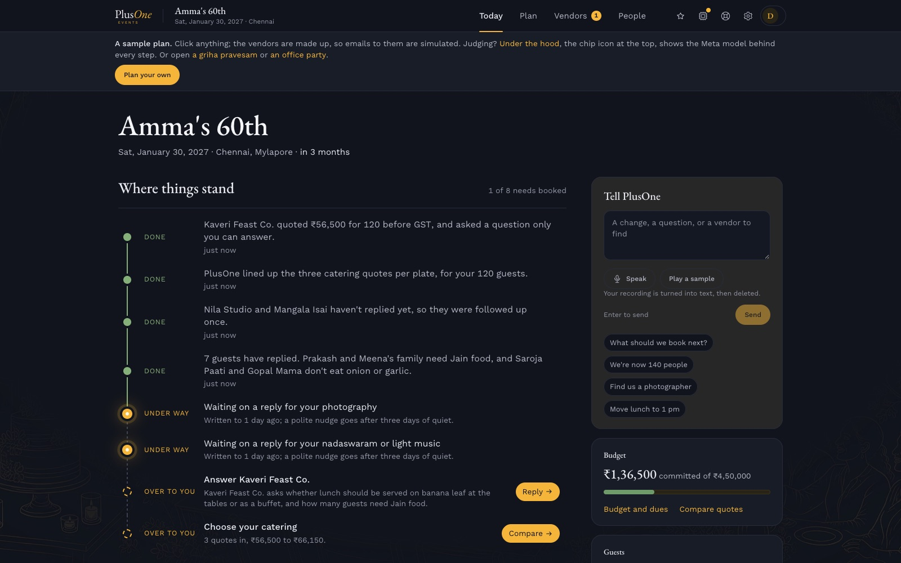

3. **Everything in one place.** Four lanes, Today, Plan, Vendors and People, hold the functions, to-dos, budget, vendors, inbox, guests, gifts and the event page, so nothing lives in a separate spreadsheet or chat (`src/components/EventLayout.tsx`). The words follow the event: functions and guests for a birthday, sessions and attendees for a conference.

<table>
<tr>
<td width="30%" valign="top">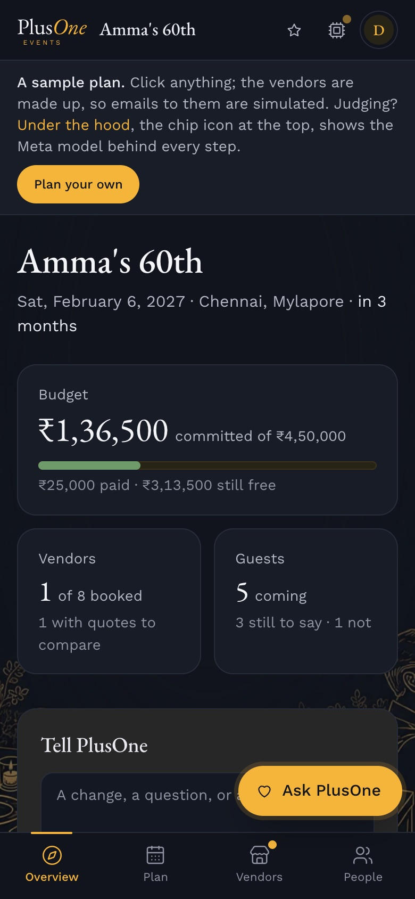</td>
<td valign="top">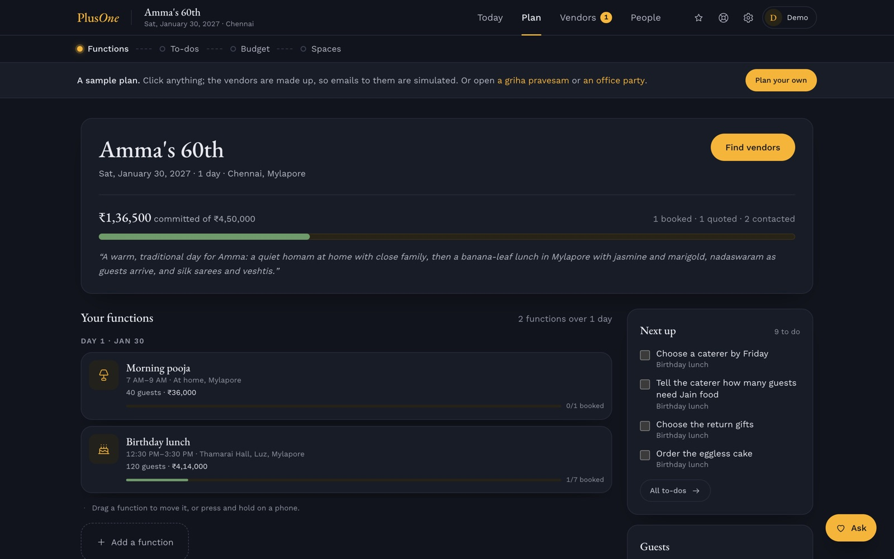 On a phone, Today opens on the box to tell PlusOne a change, and the four lanes move to a bar along the bottom. On a laptop, the Plan lane: the event, the money committed so far, its two functions and what to do next.</td>
</tr>
</table>

4. **Find vendors two ways.** PlusOne searches the open web, reads vendors' own sites down to their pricing pages and ranks what it finds with a reason for each, every price linked to its page. Or, on a need, see PlusOne's verified vendors for that trade and city by name, with their photo, starting price and distance from the venue, and press **Ask verified vendors** so they answer it on PlusOne Partner. A map pins the venue with a circle around it, so the host can keep to vendors nearby or look further out.
5. **Write from the event's own inbox.** PlusOne sends the inquiries from the event's address, follows up with vendors who go quiet (up to three times) and answers simple questions. Anything that is the host's to decide comes back as one clear question.

| Vendors found on the open web | The event's inbox |
|---|---|
| 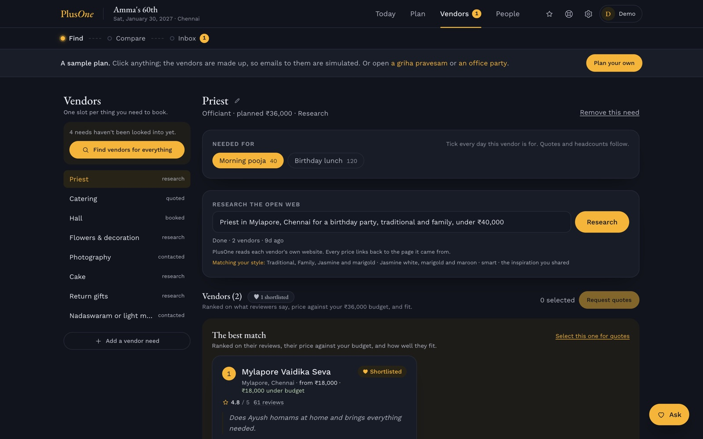 | 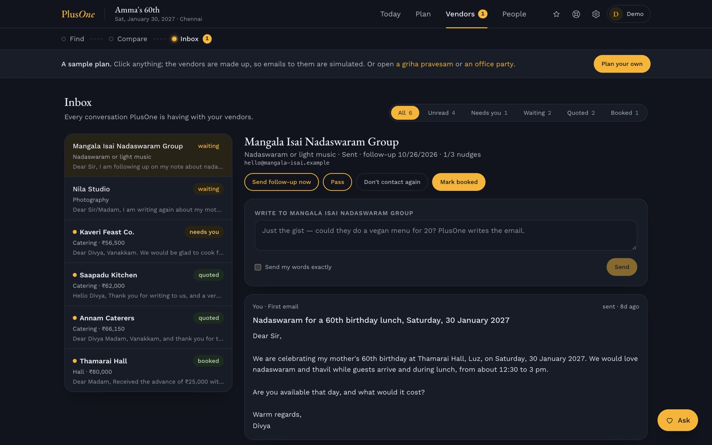 |

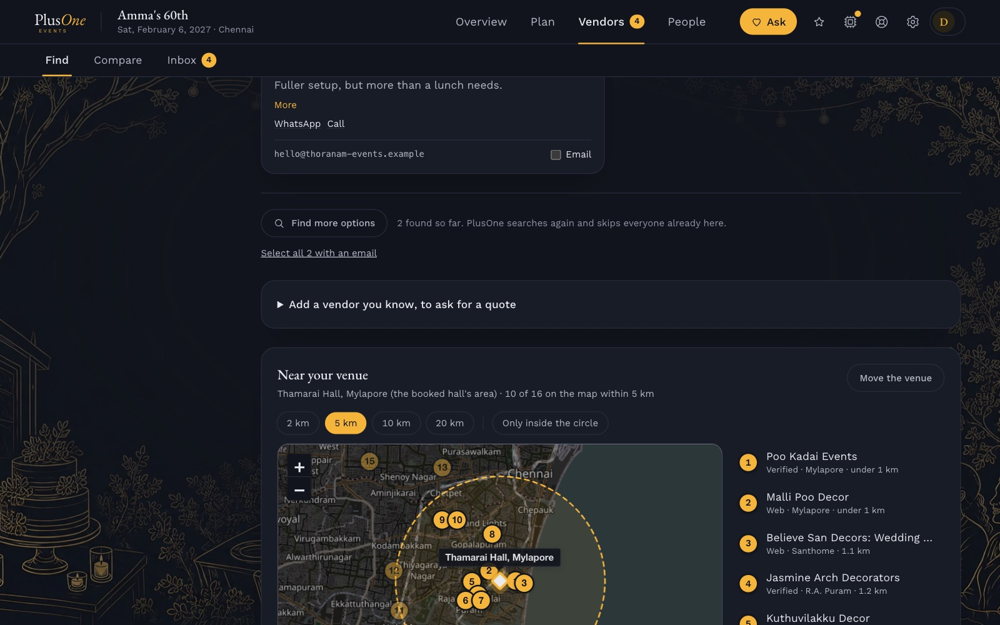

6. **Every quote on the same lines.** An emailed reply, a PDF, a photo of a price list sent on WhatsApp or a pasted message is read into the standard sheet for that kind of vendor: the unit, what's included, GST, transport, service and the usual extras (`convex/lib/standardSheet.ts`, `convex/sharedQuotes.ts`).
7. **Compare line by line.** Quotes and verified vendors' offers sit side by side in the same unit at the host's own headcount, with what each leaves unsaid flagged ("No water line, and one other charges ₹600") and where each sits in the city's price range: a bar from Value to Luxury with the typical price marked and every quote pinned on it, so the customer chooses with the whole range in view, a "What's in it" block that shows what each price includes (hours, photographers, dishes), with the lower ones marked, each Partner vendor's track record (level and events done through PlusOne), and their checked photos of past work beside their offer (`src/pages/DecisionsPage.tsx`, `src/components/PriceRange.tsx`, `convex/lib/comparable.ts`).

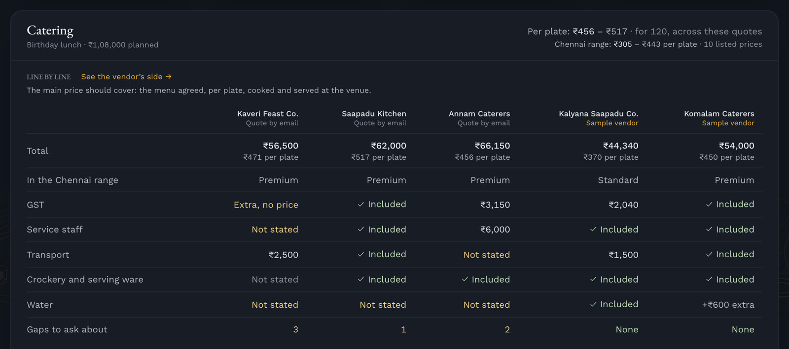

8. **See it on your venue.** From the decorators' Compare, the hall's own photo (or the sample hall) has its stage and the wall behind it found by Muse Spark and cut out by SAM 3.1, then dressed in a look: marigold and mango leaf, jasmine and rose, pastel flowers or fairy lights. A tap re-picks a part. It is a sketch to judge decorators' quotes against, drawn by the app on SAM's masks, since Muse Image isn't available in India.

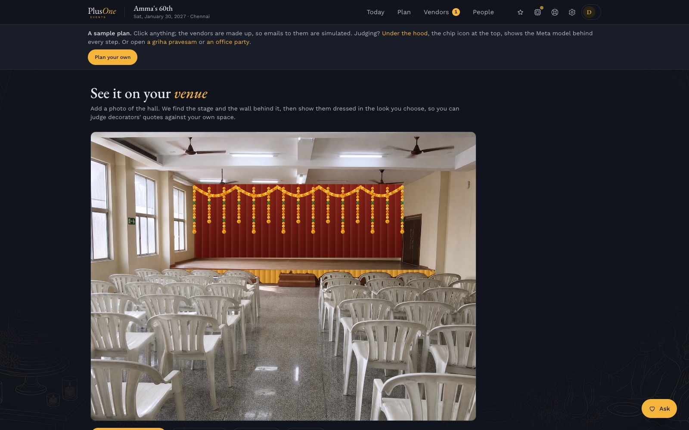

9. **Keep the budget honest.** A quote moves the budget by itself, with an undo; one that looks off (another currency, a price far from the plan) waits for the host. Every deposit, balance and vendor deadline sits in one list that can go to a calendar.
10. **Guests and the event page.** Each guest gets an invitation and their own RSVP link, and replies are saved for each function with head counts and food needs. The event page is written from the plan, and the plan can go to family or colleagues as a read-only link, or print on one page.

## Finding vendors, free

At [/vendors](https://app.plusoneevents.site/vendors), anyone can look for a caterer, decorator, photographer, hall or any other kind of vendor, with no sign-in and no plan, in their own words ("photographers near Adyar under 20k") and on a list or a map. Each listed vendor shows their packages on the standard sheet (the price, how it's charged, what's in it, GST), their checked photos of past work and their track record. A search of the open web finds vendors with their own sites who aren't on PlusOne yet, without writing to anyone. Until real vendors join as Chennai opens, the directory holds 26 sample vendors (caterers, decorators and photographers), made up and marked Sample on every card; their photos are free-licence stock pictures. To get quotes that compare, a family or event manager starts a plan; a Partner vendor's number is shared once a booking is made through PlusOne.

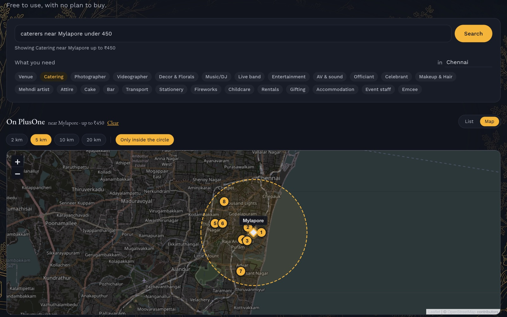

## Answering as a vendor

On PlusOne Partner, for vendors, including the many with no website or listing. It has its own demo, separate from the customers': [try it as a sample caterer](https://app.plusoneevents.site/partner/demo), with no sign-up, answering a customer's catering request and then seeing the offer the way the customer does.

1. **Get listed.** Set up the business, or claim the listing PlusOne already made from its public pages. To say where they work from, a vendor pastes the share link from their Google Maps listing, types their area or taps the map; customers see the area and the distance, never the street address. One login can run several businesses (a caterer who also does decor), each checked on its own, and a business can be removed from the same page. A person at PlusOne checks each one is real, usually within a day, and customers see it after that.
2. **Say every charge.** Partner's Packages tab adds and edits each package where it sits. Beside what's in the price, every charge on the trade's sheet is answered (in the price, added at a fixed amount, at cost, or not provided), and the vendor can name any other; a live panel shows what customers will read, and the vendor's page in Find vendors shows each charge, and any left unsaid.
3. **Price it the way the trade does.** Each package is priced as that trade charges (per plate, for the event, per hour, per kg, per session) with what's in it (hours of coverage, photographers, edited photos, dishes, delivery), and the vendor sees the exact line customers will read. Itemised prices earn the Transparent pricing badge and count towards the city's range, never with the vendor's name on them.
4. **Answer customers' requests.** Each request is for the vendor's kind of service in their city: the occasion, date, guests and area, never the customer's name, contact or budget. The vendor answers every line of the same sheet, in the price, added in ₹ or extra, and sees the total the customer will see before sending.
5. **Land in the customer's Compare.** The offer sits beside the customer's other quotes, line by line. It can be changed or withdrawn while the request is open, and a vendor's level grows with events done through PlusOne: New, Trusted after 3, Top after 10.

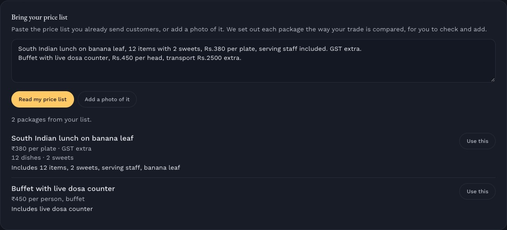
A caterer pastes the price list they already send; Muse Spark Open, Meta's open-weights model on Baseten, sets it out on the sheet in about 8 seconds, and every price is checked against the text before it is offered.

| The vendor's page | Answering a customer's request |
|---|---|
| 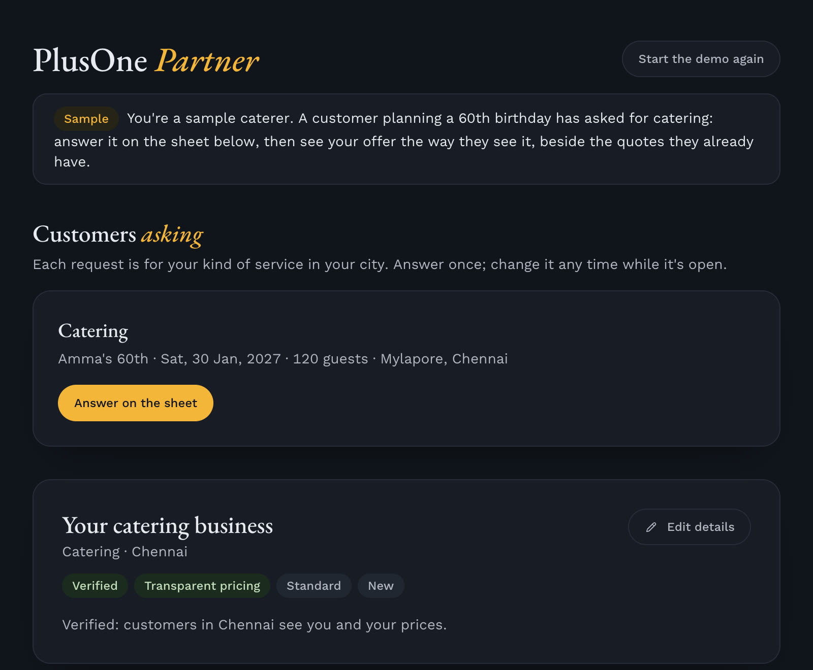 | 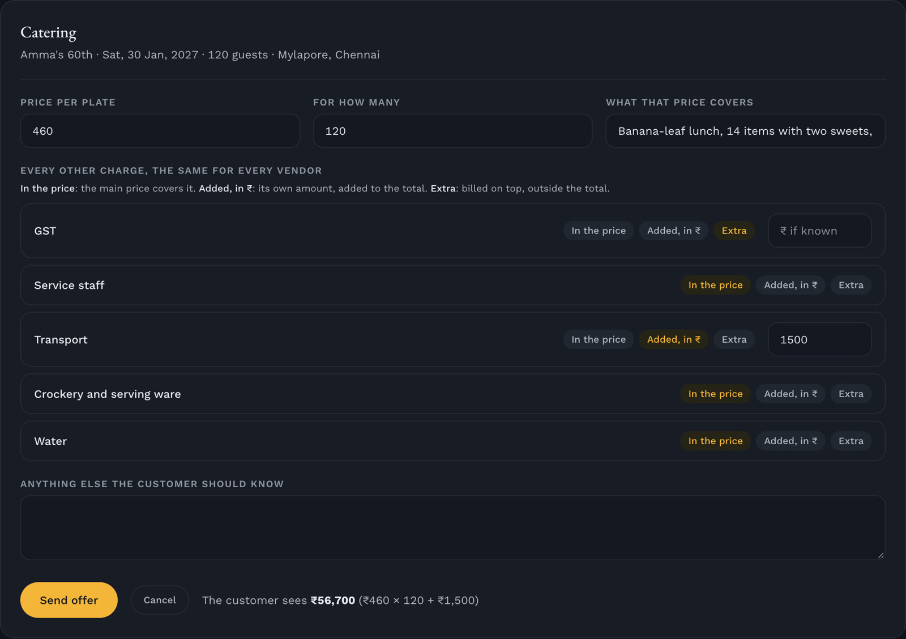 |

## Checking vendors

PlusOne Ops, at `/ops`, is the PlusOne team's side. It opens on whichever of four lanes has work: vendors to verify, claims on listings PlusOne added, photos Muse Glimmer flagged, and changes to verified listings, each change shown line by line, now against after. A vendor's review opens beside the list, with the business's own email and the account it signed in with, its prices, its photos as Muse Glimmer described and tagged them, and the evidence, and a person verifies, turns down or pauses, kept as an append-only record of who decided what on what evidence. "Check this vendor" runs a Muse Wonder check first: it searches the web and reads the vendor's own pages, then lists six findings (the business exists, the website is theirs, contact details, where they work, prices, complaints), each with the pages behind it, above the reviewer's checklist. It never ticks the checklist; a person decides. Partner's pages, backend and rules: [`src/partner/README.md`](src/partner/README.md).

## The rest of the app

- **Spaces**, one open board per event to pan and zoom, with a zone for each function or session: pictures, links from Instagram, Pinterest, TikTok or any page, notes, colour swatches and pinned vendors, with palettes suggested from the pictures.
- **People planning together:** owner, planner and viewer roles, with single-use invite links that can be revoked.
- **Emails from PlusOne:** a weekly update on Fridays that skips quiet weeks, with a way to stop it.
- **A guided tour**, "Show me around", that points at the real controls on each page.
- **Dark ink and marigold by default**, with a light theme of ink blue on ivory; pick Light, Dark or Device, and the choice carries between the home page and the app. The same line drawing, marigold at night and a soft blue by day, frames the home page, sign-in and the public pages, and sits faintly behind the app; the home page moves gently, with the hero rising in and sections rising into view. A new event's currency, and the home page's example, follow where the visitor is, so money shows in rupees in India and dollars in the US.
- **Pricing**, at [/pricing](https://plusoneevents.site/pricing): Basic is free to use until launch; Premium, where a person from the PlusOne team plans with you and is on call any time, opens after launch (`src/pages/PricingPage.tsx`).
- **It installs on a phone like an app**, and a link shared to it from another app lands in a Space.

## Care taken

- **The host stays in charge.** PlusOne never books, pays or signs. It drafts, sends and chases; every decision is the host's.
- **Nobody is pestered.** Follow-ups stop after three. A vendor who asks not to be contacted is never written to again, by any event, and first emails say how to stop them.
- **Every number has a source.** Prices link to the vendor's page or the reply they came from, and a per-plate figure is shown only when the quote's lines add up.
- **A misread price never moves the budget by itself.** Quotes that look off wait for the host, and the rest can be undone.
- **Model spend is counted, not guessed.** Every model call records its model, tokens and cost, never the prompt or the answer.
- **Usage is measured without reading what people write.** Usage events carry names and safe numbers only, stay off until a key is set, and in the browser start only once the visitor allows them.
- **Guest pages stay private.** The event page, RSVP links and shared plans use long random addresses, ask search engines not to list them, and show only the fields they need.
- **Vendors' sites are read politely.** Search obeys each site's robots.txt, never reads listing or review sites, and keeps no reviewer quotes; rankings and top picks are labelled as PlusOne's estimate.
- **Data is the host's to remove.** An event can be deleted from its settings and an account from the account page, with the files, chats and visit logs they left and the sign-in account itself.
- **WhatsApp only when asked.** A host turns quote updates on with their number and a tick, gets nothing else, and STOP or one press ends them; the webhook takes only messages Meta has signed.
- **The demo is safe to click.** Its vendors are made up and its emails are simulated, never sent; each demo visitor gets a fresh sample of their own, with tighter rate limits.
