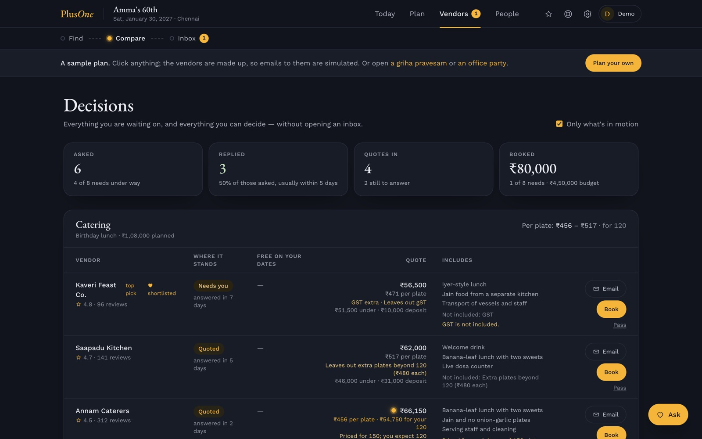

<div align="center">


# PlusOne Events

[](https://plusoneevents.site)
[](https://app.plusoneevents.site/demo)
[](#metas-models-in-plusone)
[](#how-it-works)
[](#run-it-yourself)
[](#real-runs)


[](LICENSE.md)

<table align="center">
<tr>
<td align="center" width="200"><br><b>Meta Muse Spark</b><br><sub>The reading and writing. Plans, vendor emails, quotes and replies, on Meta's Model API.</sub></td>
<td align="center" width="200"><br><b>Claude</b><br><sub>The fallback. Takes any call Meta can't answer, so nothing stalls.</sub></td>
<td align="center" width="200"><br><b>Convex</b><br><sub>The platform. Database, server functions, workflows, scheduling and webhooks in one.</sub></td>
</tr>
<tr>
<td align="center" width="200"><br><b>Firecrawl</b><br><sub>The search. Reads vendors' own websites, down to their pricing pages.</sub></td>
<td align="center" width="200"><br><b>AgentMail</b><br><sub>The event's inbox. Every event gets its own address.</sub></td>
<td align="center" width="200"><br><b>Clerk</b><br><sub>The sign-in. One account for planners, and later for vendors and staff.</sub></td>
</tr>
<tr>
<td align="center" width="200"><br><b>Resend</b><br><sub>The app's own email. The weekly update and account mail.</sub></td>
<td align="center" width="200"><br><b>PostHog</b><br><sub>The usage counts. What people do, never what they write, only with consent.</sub></td>
<td align="center" width="200"><br><b>Cloudflare</b><br><sub>The edge. Serves the site fast from India and everywhere else.</sub></td>
</tr>
</table>


</div>

PlusOne Events is a co-pilot for planning any event, for people who plan from anywhere. Tell PlusOne about the event in your own words and, once it has checked everything with you, it sets out the plan: the functions or sessions, the vendors each one needs and a budget. Then it does the slow part. It finds vendors on the open web, writes to them from the event's own inbox, chases the ones who go quiet, and lines up their quotes in one unit, per plate, per piece or per day. The host makes every decision.

It is built for the events families and teams actually hold: birthdays and sixtieths, housewarmings and griha pravesams, naming ceremonies, poojas at home, baby showers, anniversaries and engagements; office parties, team offsites, product launches, conferences, college fests and community festivals. Weddings are one of the sixteen types too.

Try it at [app.plusoneevents.site/demo](https://app.plusoneevents.site/demo), with no sign-up. Three sample events open there, all in rupees: Amma's 60th birthday in Chennai (the default), a griha pravesam in Bengaluru (`/demo?sample=housewarming`) and an office Diwali party in Gurugram with no alcohol (`/demo?sample=office`). Their vendors are made up, so nothing is really sent.

PlusOne placed second at Convex's All Gas hackathon. For the Meta Global AI Developer Hackathon (Startup track), it now reads and writes with Meta's Muse Spark, and gains a voice brief, a view of the decor on your own venue, and PlusOne Partner, where vendors list themselves and get verified.

**For the judges:** open [the demo](https://app.plusoneevents.site/demo), start on **Today**, then follow **Vendors → Compare** to see three catering quotes read into one price per plate.

## Meta's models in PlusOne


| Model | Where it works in PlusOne | Status |
|---|---|---|
| **Muse Spark 1.3** (Meta Model API) | Every reading and writing step: the planning conversation, search plans and vendor ranking, inquiries and follow-ups, quotes in replies and PDFs, RSVPs, guest-list imports, palettes and the "Tell PlusOne" box. Structured answers come back as JSON Schema, checked against the same Zod schemas | Live in production since 27 Oct 2026 |
| **Muse Voice Transcribe** | The voice brief: a family speaks the plan in Tamil, Hindi or English; a vendor talks through what they offer | Hackathon build |
| **SAM 3.1** | Cuts the stage, florals and lights out of inspiration photos for the decorators' brief, and finds the stage in a venue photo to dress it | Adapter built and tested (`convex/lib/sam.ts`: one concept or up to 16 tapped objects, masks read with `@meta-sam/parser`); the venue view is next |
| **Muse Wonder** | The verification agent in PlusOne Ops: checks a vendor's profile against their own site and public pages, with links; a person decides | Hackathon build |
| **Muse Spark Open** (open weights, on Baseten) | Batch jobs: seeding the vendor directory from public listings, and turning pooled quotes, without names, into market ranges | Hackathon build |
| **Muse Code** (Meta's coding agent) | Builds bounded pieces of PlusOne from a written brief, which are then reviewed and tested before they are committed; the first was the SAM 3.1 adapter. Every session is logged in [`devlog.md`](devlog.md#muse-code) | In use since 27 Oct 2026 |

**See it at work:** in any event, the **Under the hood** button in the top bar lists every step PlusOne ran for that event, with the Meta model that did it, how long it took and what it cost. Ask "We're now 140 people" on Today in the demo and watch the step appear.

Every call goes through one wrapper, `convex/lib/models.ts`. `MODEL_PROVIDER=meta` with a Model API key sends it to Meta; calls retry on 429, 500 and 503, honouring `Retry-After`, and a call Meta can't answer moves to Claude, with the switch logged. A request Meta rejects as malformed is raised, not hidden. Every call writes a row to `modelCalls` with its feature, model, tokens and list-price cost, so spend is known per feature and per day.

## How it works


1. **Talk it through.** "Amma's 60th in Chennai, a homam at home and lunch for about 120." PlusOne asks for whatever it still needs, one thing at a time, reads everything back for you to confirm, and points out anything that can't be right, like a weekday that doesn't match the date or a budget missing a zero. It builds the plan only once every line is confirmed. The model only reads each message; what to ask next and when the plan is ready are fixed rules (`/new`, `convex/planningChat.ts`, with the rules in `convex/lib/planningChat.ts`). A manual form at `/new/manual` does the same step by step.
2. **Open on Today.** The app opens on the co-pilot's route through the event: what is **done**, what is **under way**, what is **over to you** and what is **up next**, each with the button that finishes it. It is read straight from the plan, so it is instant and never disagrees with the pages it links to (`src/pages/TodayPage.tsx`, `convex/copilot.ts`). A box beside it takes a change or a question in plain words: "we're now 140 people", "find us a photographer".


3. **Move through four lanes.** A top bar holds Today, Plan, Vendors and People. Each lane shows its pages as stops on a line: Plan has the functions, to-dos, budget and Spaces; Vendors has Find, Compare and Inbox; People has guests, gifts, the event page and the planning team (`src/components/EventLayout.tsx`). Each function has its own time, place, headcount, budget, vendors and to-dos, and the words follow the event: functions and guests for a birthday, sessions and attendees for a conference.

<table>
<tr>
<td width="30%" valign="top"></td>
<td valign="top"><br><sub>On a phone the four lanes move to a bar along the bottom. On a laptop, the Plan lane: the event, the money committed so far, its two functions and what to do next.</sub></td>
</tr>
</table>

4. **Find vendors on the open web.** For each need, PlusOne runs several short searches at once (the kind of vendor and the area, the style, a rounded budget such as "under ₹40,000"), reads vendors' own websites down to the contact and pricing pages most searches never open, and ranks what it finds on reviews, price against the budget and fit, with a reason for each. Every price links back to the page it came from.
5. **Write from the event's own inbox.** Once the host confirms a shortlist, PlusOne sends the inquiries from the event's own address, follows up with vendors who go quiet (up to three times) and answers the simple questions they ask. Anything that is the host's to decide comes back as one clear question, on Today and in the inbox.

| Vendors found on the open web | The event's inbox |
|---|---|
|  |  |

6. **Line up quotes in one unit.** Vendors quote per plate, all in, plus service, plus transport, each for a headcount of their own choosing. A price in a reply, or in a PDF attached to it, is read into a quote with its lines, and Compare puts every quote in the same unit at the host's own numbers: per plate for food, per piece for gifts and hampers, per day for stays and transport, all in for the rest (`convex/lib/comparable.ts`). It says what each quote leaves out ("GST extra", "Priced for 150; you expect 120") and refuses a per-unit figure when the lines don't add up to the total.



7. **Keep the budget honest.** A quote moves the budget by itself, with an undo; one that looks off (another currency, an offer for something already booked, a price far from the plan) waits for the host. The budget is split by function and by kind of vendor, and every deposit, balance and vendor deadline sits in one list that can go to a calendar.
8. **Run guests and RSVPs.** Each guest gets one invitation from the event's inbox and their own RSVP link. Replies in their own words or on the link are saved for each function, with head counts and food needs, and caterers who ask get the allergies and numbers, never the names. A guest list can come in from a spreadsheet, a PDF or a paste.
9. **Give the event a page, and share the plan.** The event page is written from the plan, with dress, travel and how to reply, and stays private until it is published. A gift list lets each guest pick a gift so nobody brings the same thing twice. The plan prints on one page, or goes to family or colleagues as a read-only link with no emails, guest names or vendor contacts in it. Everything in an event can be downloaded as one file.

The rest of the app:
- **Spaces**, one open board per event to pan and zoom, with a zone for each function or session: pictures, links from Instagram, Pinterest, TikTok or any page, notes, colour swatches and pinned vendors, with palettes suggested from the pictures.
- **People planning together:** owner, planner and viewer roles, with single-use invite links that can be revoked.
- **Emails from PlusOne:** a weekly update on Fridays that skips quiet weeks, with a way to stop it.
- **A guided tour**, "Show me around", that points at the real controls on each page.
- **Dark ink and marigold by default**, with a light theme of ink blue on ivory; pick Light, Dark or Device, and the choice carries between the home page and the app. The same line drawing, marigold at night and ink blue by day, frames the home page, sign-in and the public pages, and sits faintly behind the app; the home page moves gently, with the hero rising in and sections rising into view. A new event's currency, and the home page's example, follow where the visitor is, so money shows in rupees in India and dollars in the US.
- **Pricing**, at [/pricing](https://plusoneevents.site/pricing): Co-pilot is free to use until launch, then ₹1,000 or $10 a month; Assisted, where a person from the PlusOne team plans with you and is on call any time, opens after launch at ₹2,500 or $25 a month (`src/pages/PricingPage.tsx`, prices in `src/lib/pricing.ts`).
- **It installs on a phone like an app**, and a link shared to it from another app lands in a Space.

## Care taken

- **The host stays in charge.** PlusOne never books, pays or signs. It drafts, sends and chases; every decision is the host's.
- **Nobody is pestered.** Follow-ups stop after three. A vendor who asks not to be contacted is never written to again, by any event, and first emails say how to stop them.
- **Every number has a source.** Prices link to the vendor's page or the reply they came from, and a per-plate figure is shown only when the quote's lines add up.
- **A misread price never moves the budget by itself.** Quotes that look off wait for the host, and the rest can be undone.
- **Model spend is counted, not guessed.** Every model call records its model, tokens and cost, never the prompt or the answer.
- **Usage is measured without reading what people write.** Usage events carry names and safe numbers only, stay off until a key is set, and in the browser start only once the visitor allows them.
- **Guest pages stay private.** The event page, RSVP links and shared plans use long random addresses, ask search engines not to list them, and show only the fields they need.
- **Vendors' sites are read politely.** Search obeys each site's robots.txt, never reads listing or review sites, and keeps no reviewer quotes; rankings and top picks are labelled as PlusOne's estimate.
- **Data is the host's to remove.** An event can be deleted from its settings and an account from the account page, with the files, chats and visit logs they left and the sign-in account itself.
- **The demo is safe to click.** Its vendors are made up and its emails are simulated, never sent; each demo visitor gets a fresh sample of their own, with tighter rate limits.

## Real runs

| What | Result | When | How |
|---|---|---|---|
| Muse Spark in production | A made-up guest reply ("Both of us will come. My husband is allergic to peanuts.") read by `muse-spark-1.3` through the production backend: coming, 2 people, the peanut allergy caught, valid structured output first time; 1,214 tokens in, 880 out, $0.0053, written to `modelCalls` | 27 Oct 2026 | `npx convex run claude:readRsvpReply` against production |
| Muse Spark's reasoning | At `reasoning_effort: low` a one-line reply used 194 reasoning tokens; capped at 400 output tokens, reasoning took 398 and the answer came back empty. Every call site allows 16,000 | 27 Oct 2026 | Two direct Chat Completions calls |
| Tests | 409 passed in 44 files, including the quote comparison, the Meta provider switch and its fallback, the cost record, the planning conversation's rules, the board's geometry, the co-pilot's route and a contrast check of every text colour in the light and dark themes | 27 Oct 2026 | `npm test` |
| Typecheck, app and backend | Clean | 27 Oct 2026 | `npm run typecheck` |
| The three sample events | Each opened from `/demo` for a new visitor (the birthday, `?sample=housewarming`, `?sample=office`); eleven screens captured with 0 page errors; at phone width (390 px) the page is exactly as wide as the screen, with no sideways scroll | 25 Oct 2026 | Headless Chrome (playwright-core) against the dev server and the dev backend; these are the screenshots in this README |
| Vendor search terms, old against new | Vendors' own websites among results kept: 9 of 27 with the new short terms against 5 of 26 with the old single sentence, for about half the credits | 20 Oct 2026 | A one-off before/after run of three briefs against Firecrawl |
| Page load from India | First byte in 0.08–0.09 s from Cloudflare's edge, down from 0.9–1.2 s | 18 Oct 2026 | `curl` timing from Chennai |

## The tech, part by part

| Part | Built with | What it does |
|---|---|---|
| App | React 19, React Router 7, Vite 8, Tailwind CSS 4, dnd-kit, lucide-react, EB Garamond and Work Sans | Every screen, in `src/pages/` and `src/components/`; the four-lane top bar in `src/components/EventLayout.tsx`; the themes in `src/lib/theme.ts` and `src/index.css` |
| Backend and database | Convex 1.45, with the workflow, workpool, rate-limiter, action-cache and static-hosting components | Schema, queries, mutations, actions, crons and webhooks in `convex/` |
| The planning conversation | Muse Spark (fast tier) plus own rules | `convex/planningChat.ts` reads each message into facts; `convex/lib/planningChat.ts` decides what to fix, ask or read back and when the plan is ready; `convex/lib/wizard.ts` fills in defaults by event type from `convex/lib/templates.ts` and turns the result into an event; the page is `src/pages/NewEventPage.tsx` |
| Event types | Own code | Sixteen types in three groups (family, work and community, other), with the words each one uses, in `convex/lib/occasion.ts` |
| Today | Own code, no model | The co-pilot's route in `convex/copilot.ts`, drawn by `src/pages/TodayPage.tsx`; the "Tell PlusOne" box goes to `convex/assistant.ts`, and anything it proposes to change waits on a card until someone presses its button |
| Reading and writing | Meta's Muse Spark (`muse-spark-1.3`, Standard) through the Model API's Chat Completions, with structured output as JSON Schema; Claude (`claude-sonnet-5-5`, `claude-haiku-5-5`) as the fallback | `convex/lib/models.ts` picks the provider from `MODEL_PROVIDER`, sends one house style ahead of every request, retries Meta on 429/500/503, moves a call to Claude when Meta can't answer, and writes each call's tokens and list-price cost to `modelCalls`; adapters in `convex/lib/meta.ts` and `convex/lib/claude.ts` |
| Cost record | Own code | `convex/modelCalls.ts` writes one row per model call; prices per million tokens for Muse Spark, Muse Wonder and the Claude fallback in `convex/lib/modelCost.ts`. The row is written before the answer is checked, since an answer that fails validation was still paid for |
| Vendor search | Firecrawl | Short search terms in `convex/lib/searchTerms.ts`; research, ranking and contact and pricing pages in `convex/research.ts` and `convex/firecrawl.ts`, with what may be read decided in `convex/lib/scrapePolicy.ts` and a cache in `convex/webCache.ts` |
| The event's inbox | AgentMail | One inbox per event, named after the hosts' first names on the deployment's domain, in `convex/agentmail.ts` and `convex/lib/inboxName.ts`; sending, replies and follow-ups in `convex/outreach.ts`, `convex/inbound.ts` and `convex/followups.ts`; the do-not-contact list in `convex/doNotContact.ts`. Each deployment keeps its inboxes in its own AgentMail pod, with a webhook that hears only that pod |
| Quotes in one unit | Own code | `convex/lib/comparable.ts` puts each quote per plate, per piece, per day or all in, at the host's numbers, with its flags; `convex/quotes.ts` and `convex/lib/quoteHold.ts` decide when a quote waits and handle the undo; the page is `src/pages/DecisionsPage.tsx` |
| Budget, dues and currencies | Own code | `convex/budget.ts` and `convex/dues.ts`; the calendar file is made in the browser by `src/lib/calendar.ts`; currency by region in `src/lib/currency.ts` and `src/lib/region.ts` |
| Sample events | Own code | `convex/demoBirthday.ts` (Chennai), `convex/demoHousewarming.ts` (Bengaluru) and `convex/demoOfficeParty.ts` (Gurugram), started fresh for each visitor by `convex/demo.ts` and `src/pages/GuestPage.tsx` |
| Sign-in | Clerk, with Convex Auth for the demo | Accounts sign in with Clerk in `src/lib/session.tsx` and `src/pages/SignInPage.tsx`; the first sign-in finds an earlier account by its verified email, in `convex/users.ts`. Demo visitors get short-lived guest tokens from Convex Auth (`convex/auth.ts`), so the demo needs no account |
| Guests, event page and gifts | Own code | Guests and RSVPs in `convex/guests.ts` and `convex/lib/rsvp.ts`; the event page in `convex/site.ts` with `src/pages/SitePage.tsx` and `src/pages/RsvpPage.tsx`; gifts in `convex/gifts.ts` |
| Spaces | Own code, plus TikTok, Pinterest and YouTube previews and any page's own tags | The board in `src/components/board/Board.tsx`, with its geometry in `src/lib/board.ts`; `convex/spaces.ts` for pictures, links, notes, swatches, pinned vendors, previews and palettes (suggested by Muse Spark), with `convex/lib/links.ts`, which refuses private addresses; the phone share target in `public/manifest.webmanifest`, landing in `src/pages/SharePage.tsx` |
| Sharing, import and export | Own code, fflate for spreadsheets, plus Muse Spark | Read-only links in `convex/shareLinks.ts`, the one-page plan in `src/components/PlanSheet.tsx`, the full download in `convex/exports.ts`; guest-list imports in `convex/guestImport.ts` |
| App emails | Resend, via the Convex component | The weekly update in `convex/digest.ts`, sent Fridays by `convex/crons.ts`, through the Resend client in `convex/appEmails.ts`; the +1 logo for mail apps that show one in `public/bimi.svg` |
| Usage | PostHog | Counts what people do, never what they write, in `convex/analytics.ts` and `src/lib/analytics/`; it starts only after a visitor allows analytics on the consent bar (`src/components/ConsentBar.tsx`), with session recordings off, and `functions/ingest/` forwards events without the visitor's IP address |
| Hosting | Cloudflare Pages and a Worker, Convex in Ireland | The built app is served from Cloudflare's edge on plusoneevents.site (home) and app.plusoneevents.site (app); `src/lib/hosts.ts` keeps each page on its own address, and `functions/geo.ts` says which country and state a visit comes from. The backend runs on Convex in Europe (Ireland) |

Rate limits on searches, emails, invites, sign-ups, planning conversations, imports, links added to Spaces, palettes, RSVPs, gifts and the assistant are in `convex/rateLimits.ts`, with tighter limits for demo visitors and a daily ceiling across all events for research, the assistant and drafting.

## Run it yourself

You need Node 20 or later, a Convex account and a Clerk application with a JWT template named `convex` (claims `aud: convex`, `name`, `email`, `email_verified`).

```bash
git clone https://github.com/pe-hq-alpha/plusone-app.git plusone && cd plusone
npm install
npx convex dev --once     # first run: sign in and create a dev deployment (writes .env.local)
npm run dev               # the app on http://localhost:5173, and the backend watching for changes
```

Or run `./start.sh`, which checks Node, installs what's missing, warns about any backend key not yet set on the deployment, and then starts both.

Backend keys are set on the deployment, for example `npx convex env set ANTHROPIC_API_KEY …`, never in a file. **To run on Meta's models**, also set `npx convex env set MODEL_PROVIDER meta` and `npx convex env set MODEL_API_KEY …` (a Meta Model API key); without them every call runs on Claude. The minimum to try it: `CLERK_JWT_ISSUER_DOMAIN`, `JWT_PRIVATE_KEY`, `JWKS` and `SITE_URL`, a model key (`MODEL_API_KEY` with `MODEL_PROVIDER=meta`, or `ANTHROPIC_API_KEY`), `FIRECRAWL_API_KEY` for vendor search, and `VITE_CLERK_PUBLISHABLE_KEY` in `.env.local`. To deploy:

```bash
npx convex deploy -y                                                    # the backend
VITE_CONVEX_URL=https://<deployment>.convex.cloud \
VITE_HOME_ORIGIN=https://<home> VITE_APP_ORIGIN=https://app.<home> \
VITE_CLERK_PUBLISHABLE_KEY=pk_live_… npx vite build                     # the app, built against it
npx wrangler pages deploy dist --project-name <pages-project>          # served from Cloudflare Pages
node scripts/agentmail-setup.mjs https://<deployment>.convex.site <pod-id>   # once: the inbox webhook
```

The app can also be served by Convex itself: `npm run deploy`.

Every push to `main` runs typecheck and tests in CI. A staging workflow (`.github/workflows/staging.yml`) deploys each green push to a separate backend and site once its deploy keys are set as repository secrets; production is deployed by hand.

| Variable | For |
|---|---|
| `ANTHROPIC_API_KEY` | Claude: the fallback for every model call, and the provider when `MODEL_PROVIDER` isn't `meta` |
| `ANTHROPIC_MODEL_SMART`, `ANTHROPIC_MODEL_FAST` | Optional. Override `claude-sonnet-5-5` and `claude-haiku-5-5` |
| `MODEL_PROVIDER` | `meta` to run model calls on Meta's models; anything else (or unset) uses Claude |
| `MODEL_API_KEY` | Meta Model API key. Without it, `MODEL_PROVIDER=meta` falls back to Claude |
| `META_MODEL_SMART`, `META_MODEL_FAST` | Optional. Override `muse-spark-1.3` per tier (Contributor ids are refused) |
| `META_BASE_URL` | Optional. The Model API address, `https://api.meta.ai/v1` by default |
| `FIRECRAWL_API_KEY` | Vendor search |
| `AGENTMAIL_API_KEY`, `AGENTMAIL_WEBHOOK_SECRET`, `AGENTMAIL_INBOX_DOMAIN` | The event inboxes and their incoming mail |
| `AGENTMAIL_FALLBACK_INBOX_ID` | Optional. An inbox to use when an event can't get its own |
| `AGENTMAIL_INBOX_LIMIT` | Optional. How many inboxes the AgentMail plan allows, 3 by default |
| `AGENTMAIL_POD_ID` | Optional. The AgentMail pod this deployment keeps its inboxes in, so production and dev never share mail |
| `SITE_URL` | Links in emails back to the app |
| `CLERK_JWT_ISSUER_DOMAIN` | The Clerk instance whose sign-ins the backend accepts, such as `https://clerk.<home>` |
| `CLERK_SECRET_KEY` | Optional. Deletes the person at Clerk too when an account is deleted |
| `VISIT_LOG_SECRET` | Optional. Shared with the Cloudflare middleware, which sends each visit for the security log |
| `JWT_PRIVATE_KEY`, `JWKS` | Keys for the demo's guest tokens (Convex Auth) |
| `RESEND_API_KEY`, `EMAIL_FROM` | The app's own emails |
| `EMAIL_LIVE` | Optional. `1` to send app emails; anything else keeps them in test mode |
| `EMAIL_UNSUBSCRIBE_SECRET` | Signs the stop links in app emails |
| `POSTHOG_KEY`, `POSTHOG_HOST` | Optional. Usage events from the server |
| `VITE_CONVEX_URL` | The app's link to its backend (written by `npx convex dev`) |
| `VITE_CLERK_PUBLISHABLE_KEY` | The app's Clerk key: `pk_test_…` for development, `pk_live_…` for the live site |
| `VITE_POSTHOG_KEY`, `VITE_POSTHOG_HOST` | Optional. Usage events from the app |
| `VITE_HOME_ORIGIN`, `VITE_APP_ORIGIN` | Optional. The home page's address and the app's; set both to split them across two addresses, or neither to keep one |

## Status and limits

Planning works end to end: the planning conversation, the plan, Today, vendor search, emails, replies, quotes in one unit, the budget and dues, guests and RSVPs, the event page, gifts, sharing, imports, Spaces, the weekly update and people planning together.

- Vendor search is only as good as vendors' own websites: a vendor with no prices online comes back without one, until it replies.
- Compare shows the range across the quotes an event has received; a price that cannot be put in the unit honestly is shown as quoted, not converted.

## Next steps

- **The voice brief:** speak the plan; Muse Voice Transcribe hears it, Muse Spark turns it into the plan.
- **See it on your venue:** SAM 3.1 finds the stage in your venue photo and dresses it in your palette, so a decorator's quote is judged against a picture.
- **PlusOne Partner:** vendors claim their listing, describe their services by voice, price their packages in the units families compare, and get verified in PlusOne Ops with evidence gathered by Muse Wonder.
- **Market ranges in Compare:** quotes pooled across events, without names, into a range for each kind of vendor and city.
- **WhatsApp and calling:** reach a vendor on WhatsApp or by phone from the app.
- **PlusOne Admin:** visits, sign-ups, the funnel and model spend in one place for the team.
- **A team on the ground:** people who step in when an event needs hands, alongside the co-pilot.
- **Billing:** Stripe outside India and Razorpay in India.
- **The long run:** standard vendor prices and a vetted vendor network, booked through PlusOne.

## Repository

**History.** PlusOne Events is an early-stage startup being built in semi-stealth, so this repository starts from a snapshot of earlier private work rather than its full history. The first commit, tagged [`pre-hackathon`](../../tree/pre-hackathon) (26 October 2026, 14:58 IST), is the product as it stood before the hackathon. Kickoff was 26 October at 9:30 PM IST: eleven commits made that afternoon, before kickoff, are privacy and trust groundwork, and every commit from 27 October (`608627f`) on was made during the hackathon. [`devlog.md`](devlog.md) sets out each day's work. The earlier history is kept privately.


| Path | What it is |
|---|---|
| `src/pages/` | One file per screen: Today, the plan and each function, to-dos, budget, Spaces, Find, Compare, Inbox, guests, gifts, the event page, the planning team, settings and the new-event pages, plus the guest pages for the event page, RSVP links and shared plans |
| `src/components/` | Shared pieces: the four-lane layout (`EventLayout.tsx`), the guided tour, the wordmark in `src/components/brand/` |
| `convex/` | The backend: `schema.ts` and one file per area, with tests beside them |
| `convex/lib/` | Pure rules shared with the app: quote comparison, the planning conversation's rules, event types and their words, templates, inbox names, search terms |
| `scripts/` | `agentmail-setup.mjs` registers a deployment's inbox webhook; `fake-webhook.mjs` sends a signed test email to it |
| `functions/` | Cloudflare Pages Functions: `geo.ts` for a visit's country and state, `ingest/` for analytics |
| `public/` | Icons, the install manifest, the share image and the mail logo |
| `assets/` | This README's banner and Meta models image (sources in `assets/src/`), screenshots and logos |

```bash
npm test             # backend and app tests
npm run typecheck    # app and backend
npm run build        # production build
```

## License

[FSL-1.1-ALv2](LICENSE.md), the Functional Source License. You can read, run and change it for anything except offering a competing commercial product. Each version becomes Apache 2.0 two years after it's published.
