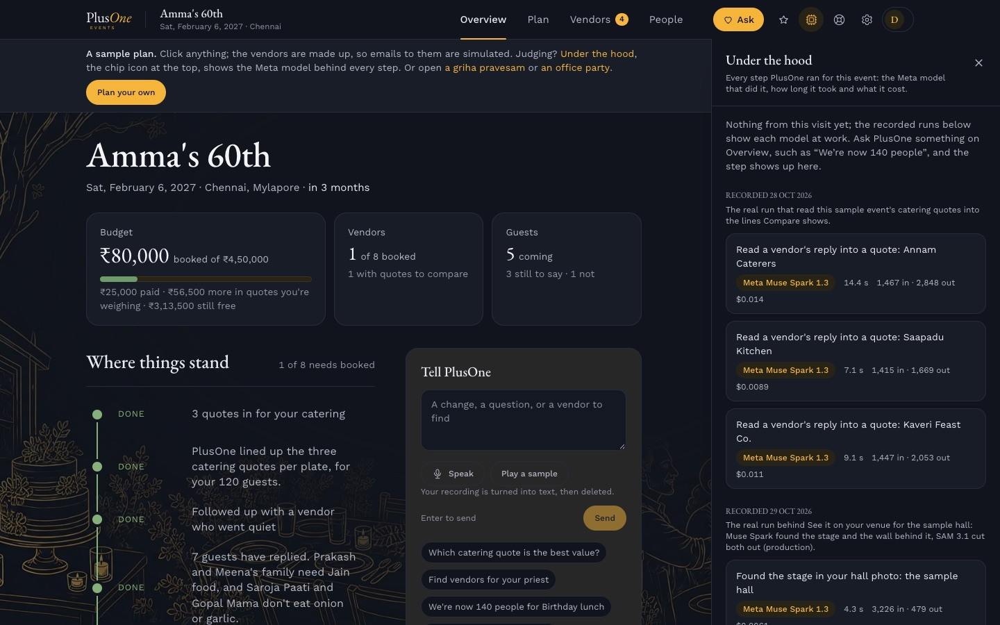
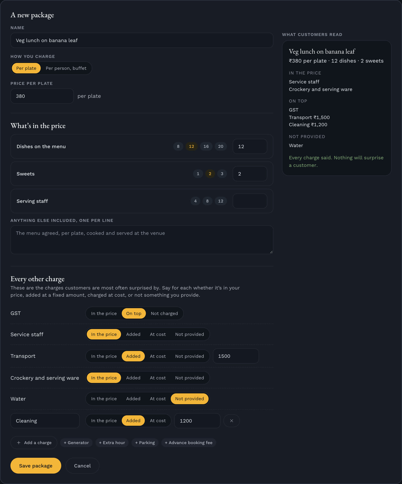

<div align="center">


# PlusOne Events

[-ff0033?style=for-the-badge&logo=youtube&logoColor=white&labelColor=11141c)](https://youtu.be/rlMwQiZfW2g)
[](https://plusoneevents.site)
[](#for-the-judges)
[](https://app.plusoneevents.site/demo)
[](#metas-models-in-plusone)
[](#how-it-works)
[](#run-it-yourself)
[](#measured-results)
[](#coming-next)


[](LICENSE)

<table align="center">
<tr>
<td align="center" colspan="7"><a href="#metas-models-in-plusone"></a><br><b><a href="#metas-models-in-plusone">Meta's models</a></b><br><sub>Muse Spark, Muse Voice Transcribe, Muse Wonder, SAM 3.1, and the open-weights Muse Glimmer and Muse Spark Open, with Muse Code as our pair programmer. <a href="#metas-models-in-plusone">What each one does</a></sub></td>
</tr>
<tr>
<td align="center" width="80"><br><sub><b>Modal</b><br>Muse Glimmer's GPU</sub></td>
<td align="center" width="80"><br><sub><b>Baseten</b><br>Muse Spark Open</sub></td>
<td align="center" width="80"><br><sub><b>Convex</b><br>Backend and jobs</sub></td>
<td align="center" width="80"><br><sub><b>Firecrawl</b><br>Vendors' websites</sub></td>
<td align="center" width="80"><br><sub><b>AgentMail</b><br>Event inboxes</sub></td>
<td align="center" width="80"><br><sub><b>Clerk</b><br>Sign-in</sub></td>
<td align="center" width="80"><br><sub><b>OpenStreetMap</b><br>Vendor map</sub></td>
</tr>
<tr>
<td align="center" width="80"> <br><sub><b>React + Vite</b><br>Screens and build</sub></td>
<td align="center" width="80"><br><sub><b>Tailwind CSS</b><br>Styling</sub></td>
<td align="center" width="80"><br><sub><b>Vitest</b><br>Tests</sub></td>
<td align="center" width="80"><br><sub><b>Resend</b><br>App emails</sub></td>
<td align="center" width="80"><br><sub><b>Cloudflare</b><br>Hosting</sub></td>
<td align="center" width="80"><br><sub><b>PostHog</b><br>Usage, with consent</sub></td>
<td align="center" width="80"><br><sub><b>WhatsApp</b><br>Quote updates</sub></td>
</tr>
</table>


</div>


> **PlusOne brings the scattered work of planning an event into one place, and puts every vendor's quote on the same lines, so families and event managers know what they're paying for.**
>
> We're building a standardised way to plan events, where customers often struggle to compare quotes, understand what's included and coordinate fragmented vendors. AI turns the planning process into a structured, transparent workflow.

Two sides meet on the same lines: families and event managers plan in PlusOne, and verified vendors answer the same brief on PlusOne Partner.

**Built during the hackathon (27 Oct – 4 Nov):** six Meta models at its core, the standard sheet with missing charges flagged, Compare with the market range, PlusOne Partner and Ops, voice and call reading, the venue view, photo and vendor checks, the open directory and map, and Under the hood. Before it, PlusOne was a planner: the planning chat, vendor search, the event's inbox and follow-ups, the budget, guests and RSVPs (tag `pre-hackathon`). Every addition, dated: [WHATS-NEW.md](WHATS-NEW.md).

Planning an event means juggling: vendors on calls and WhatsApp, quotes in email and PDFs, the budget in a spreadsheet, the guests in another list. And no two quotes are written alike, so nobody can tell what's included until the extra charges arrive. PlusOne solves both:

1. **One app instead of many tools.** An all-in-one event planner: the plan and its budget, vendors found and written to, every reply read and chased, guests, RSVPs and the event page, for an event of any size.
2. **Quotes you can compare, and vendors you can find.** Every quote and every vendor's offer lands on the same lines, so what's included, what's extra and what's missing is plain, along with where each price sits in the market. Vendors with no website or listing get a place to be found, and answer customers on those same lines.

**What it saves.** On the founders' own baby shower, ₹29,500, about 10% of what was quoted, came as charges no headline price stated, and on those quotes PlusOne flags the unstated lines the biggest extra came under ([measured](#measured-results)). In the demo's made-up 60th-birthday lunch, the quote that looks cheapest is the dearest once its minimum order, service, transport and GST sit on the same lines; choosing the one that really is cheaper saves the host about 10%. An event hires many vendors (the average wedding, 14), so if the same 10% holds across the package, a ₹5 lakh event keeps about ₹50,000 and a ₹20 lakh wedding about ₹2 lakh.

We start where we live: in India, weddings alone are about $130 billion a year (Jefferies, 2024), 87% of the industry is unorganised and the average wedding hires 14 vendors (Kotak Mutual Fund, Nov 2025). Demand is never the question; what's missing is one organised place where every price can be seen and compared. The aim is to standardise how events are planned, so that every event gets a clear budget, comparable vendor options, transparent pricing and a predictable way to get it done, whatever its size: a first birthday as much as a wedding.


One platform, with layers that feed each other:

| Layer | For | What it does | Status |
|---|---|---|---|
| **PlusOne Basic** | Families and teams planning their own event, and event managers planning for their clients | Plans with you, finds vendors, writes to them from the event's own inbox, chases them, reads their quotes into one unit and keeps the budget. The host makes every decision | Live, free until launch, then ₹1,000 ($10) a month |
| **PlusOne Premium** | People who want a person beside them | Everything in Basic, plus a real person from the PlusOne team in real time and on call | Opens after launch, ₹2,500 ($25) a month |
| **PlusOne Partner** | Vendors, including the many with no website or listing | Register, price packages in the units customers compare, answer a customer's brief, get verified and get found | Built during the hackathon, live since 28 Oct; the demo's vendors are samples, and real vendors join as the first city opens; a listing subscription after launch |
| **PlusOne Ops** | The PlusOne team | Verifies each vendor with the evidence Muse Wonder gathers, approves vendors' photos and changes to verified listings | Live since 28 Oct, for the founders |

More vendors on Partner widen what customers can compare; more customers bring vendors work; every quote read into the same lines sharpens the market range for the next event. It is built for the events people actually hold: birthdays and sixtieths, housewarmings, naming ceremonies, poojas, baby showers, engagements, office parties, offsites, launches, conferences, college fests and community festivals. Weddings are one of the sixteen types too.

**How it started.** PlusOne began as a small wedding-planning app and placed second at Convex's All Gas hackathon in September 2026. The families, event managers and vendors we spoke to all pointed at the same gap: there is no organised way to plan an event and know what you're paying for. For the Meta Global AI Developer Hackathon (Startup track), PlusOne is built on Meta's models, with the pieces that make prices comparable at the source.

**Team:** Padmanabhan Rajendrakumar, Founder, who built this entry and submits it, with Sharmila Raghu, Co-Founder of PlusOne.

## For the judges

**Try it in two minutes.** [The demo](https://app.plusoneevents.site/demo) opens a sample 60th birthday with no sign-up, in the visitor's own money: Dad's 60th in Austin, in dollars (`/demo?region=US`), or Amma's 60th in rupees (`/demo?region=IN`) (also a housewarming, `/demo?sample=housewarming`, and an office Diwali party, `/demo?sample=office`; their vendors are made up, so nothing is really sent).
1. Start on **Overview**, then **Vendors → Compare**: three caterers' emailed quotes and two sample Partner vendors' offers sit line by line on the same sheet, with what each leaves out flagged ("No water line, and one other charges ₹600") and the city's price range beside them.
2. Press **Under the hood** in the top bar for each step's Meta model, time and cost; type "We're now 140 people" on Overview to watch one run.
3. Open [PlusOne Partner's demo](https://partner.plusoneevents.site/demo) as a sample caterer, answer the customer's request on the same sheet, and see the offer as the customer does.
4. Open [Find vendors](https://app.plusoneevents.site/vendors) and search "caterers near Mylapore under 450": vendors on a map in a circle around the area.

**In a few words.** The *standard sheet* is the set of lines every quote for a kind of vendor is read into (the unit, what's included, GST, transport, service, extras). *Value*, *Standard*, *Premium* and *Luxury* say where a price sits among the city's listed prices for the same unit (the lowest quarter, the middle half, up to the 90th percentile, above it), and the *typical price* is the middle; none says a price is fair or unfair. *Verified* means a person in Ops checked the vendor; *Sample* marks a made-up vendor or event.

**Money.** Finding vendors is free. Basic is free until launch, then ₹1,000 ($10) a month. Premium, with a person from the PlusOne team planning beside you, is ₹2,500 ($25) a month. Vendors will pay a listing subscription on Partner after launch; listing is free until then. The end goal is a disclosed commission on bookings paid through PlusOne, once the vendor network and trust exist. Full launch is planned for the 2026 holiday season or early 2027 ([The business](#the-business)).

### The theme: Build for Your World

> "Bring Meta's models into your domain. Solve a problem you know firsthand, free up time and mental space, and make something possible that wasn't before."

| The theme asks | PlusOne's answer |
|---|---|
| **Bring Meta's models into your domain** | Event planning on six Meta models. Muse Spark reads replies, quotes, PDFs and photos, in English or mixed with a local language, into the same lines; Muse Voice Transcribe hears a spoken plan, and a vendor's call speaker by speaker; SAM 3.1 cuts the stage out of the customer's own hall photo to dress it; Muse Wonder checks a vendor's evidence in Ops; and two open-weights models, Muse Spark Open on Baseten and Muse Glimmer on our own Modal GPU, read vendors' price lists and check photos of their work. All live in production |
| **A problem you know firsthand** | We just lived it, planning a half-day baby shower for 120. Other halls quoted about ₹2 to ₹3.5 lakh with AC, parking and rooms on top; the hall we booked at ₹75,000 cost ₹20,000 more because the decorators needed it from 11 pm the night before. Decorators priced a design from a photo on WhatsApp, each differently, and delivered late with fewer of the lilies we'd asked for. The caterer's transport was about four times what we'd have paid ourselves, with serving and cleaning outside the per-plate price. Every price came as a WhatsApp message, a call or a scribbled note, never in one place. That was one small morning; a wedding runs for days. PlusOne is the app we wished we'd had |
| **Free up time and mental space** | PlusOne does the legwork: it searches, writes from the event's own inbox, chases vendors up to three times, reads every reply and PDF into one unit and says what each quote leaves out. The host only decides |
| **Make something possible that wasn't before** | A family planning a birthday gets what only a wedding with a planner got before: offers on the same lines, missing charges flagged and the market range. An event manager gets it for every client's event. A vendor with no website gets found and answers briefs. A plan can be spoken instead of typed, and the decor seen on the real hall before anyone pays |

### Built during the hackathon (27 Oct – 4 Nov 2026)

Before the event, PlusOne was a planner that talked a plan through, wrote to vendors and put their quotes in one unit (tag `pre-hackathon`). In nine days it grew into a two-sided platform with six Meta models at its core: about 400 commits, the code from about 41,000 lines to about 72,000, and the backend from 124 files to 238. Everything below was built during the event; **[the full list, with dates, files and measured runs, is in WHATS-NEW.md](WHATS-NEW.md)**.

| What | Meta model | Status |
|---|---|---|
| Muse Spark at the core, through one wrapper with retries, a logged fallback and a cost row per call; the assistant changes the plan when told ("we're now 140 people") | Muse Spark 1.3 | Live, 27 Oct |
| **Under the hood:** every step with its model, time and cost, and recorded real runs of each model in the demo (Muse Spark reading three catering quotes in 7–14 s each, $0.033 in all; the hall's stage found and cut out in 4.3 s and 4.0 s; a photo checked in 5.6 s) | All six | Live, 27 Oct; recorded runs 28–30 Oct |
| **The standard sheet** for ten trades, from venue, catering and decor to makeup and the priest; **missing charges flagged** and **Compare line by line** with the city's market range | Muse Spark reads; fixed, tested rules decide | Live, 28 Oct |
| **Any quote, any form:** an email, a PDF, a WhatsApp photo or pasted message, or a recorded phone call heard speaker by speaker, all read into the same lines | Muse Spark, Muse Voice Transcribe | Live, 28–29 Oct |
| **The voice brief:** speak the plan instead of typing it | Muse Voice Transcribe, Muse Spark | Live, 28 Oct |
| **See it on your venue:** the hall's own photo with its stage found, cut out and dressed in a look | Muse Spark, SAM 3.1 | Live, 29 Oct |
| **PlusOne Partner:** vendors join or claim a listing, price on the standard sheet, bring their own price list, answer briefs into the customer's Compare; wording tidied, photos checked; a vendors' demo of its own | Muse Spark, Muse Spark Open, Muse Glimmer | Live, 28–29 Oct |
| **PlusOne Ops:** a verification agent gathers evidence with links, a person decides; photos flagged; changes to verified listings wait for approval | Muse Wonder, Muse Glimmer | Live, 28–29 Oct |
| **Track record beside each price** (New, Trusted, Top, from events done through PlusOne, never bought) | | Live, 29 Oct |
| **Find vendors, open to everyone,** and **vendors on a map** around the venue, with plain searches ("caterers near Mylapore under 450") | Muse Spark; Firecrawl; OpenStreetMap | Live, 29–30 Oct |
| **WhatsApp and Call for every vendor**, with the first message written for the event | | Live, 29 Oct |
| **Quote updates on WhatsApp** for hosts who opt in, with STOP to end them; 11 tests | Meta's WhatsApp Cloud API | Built 30 Oct; connected to Meta's test number while the message waits for Meta's approval |
| **Vendors pin where they work from their Google Maps link**; **one login runs several businesses**, each verified on its own | | Live, 31 Oct |
| **Every charge on a package:** Partner rebuilt as tabs (Requests, Packages, Photos, Details), packages added and edited in place, and each one says every charge, in the price, added, at cost or not provided, beside a live view of what customers read; customers see them on the vendor's page | | Live, 31 Oct |
| **A planning conversation that probes like a planner:** it asks a wedding's tradition, never assuming one, offers that tradition's events of the day to tick from a hand-checked list with its own suggestions marked, checks timings, asks once what is often missed, and builds the plan day by day beside the talk, editable | Muse Spark 1.3 (rebuilt on the pre-hackathon chat) | Live, 31 Oct |
| **Vendors found on the open web,** listed openly as "not yet verified" with a link to their own site, to be claimed or removed by the business; vendor research searches the host's own words, never a price | Firecrawl, within robots.txt | Live, 31 Oct |
| **Shared links that show the event:** an event page, RSVP or plan link shows the event's name, date, place and picture; each kind of event has its own line drawing, or the host's own picture. The event page opens on that picture, with the day as a timeline, a calendar file and directions | | Live, 31 Oct |
| **A WhatsApp quote dropped on the event:** paste the message or drop the screenshot with no vendor or need chosen; it finds its vendor and need, adds them if new, and lands in Compare | Muse Spark 1.3 | Live, 31 Oct |
| **A quote a vendor told you, on the need's own page:** type it, say it into the microphone, add a call recording or a photo, for a vendor already there or a new name, with the price per plate or for everything if you have it; it sits line by line beside the emailed quotes, marked "Added by you", with Book | Muse Spark 1.3 (reading the words), Muse Voice Transcribe (speaking it) | Live, 1 Nov |
| **A vendor booked outside PlusOne, in one step:** name, price agreed and what's paid; the need is booked, the budget takes the price, what's paid is marked paid and the balance goes on what's due. The assistant offers the same step as a "Do it" card | Muse Spark 1.3 (the assistant's card) | Live, 1 Nov |
| **Overview, milestones, RSVP links and Notes to self:** the event opens on the budget, vendors booked and people coming; where things stand reads as milestones in the need's own name, never a vendor's; the event page lists everyone's own RSVP link to copy or send on WhatsApp; to-dos became Notes to self, a sticky note the host writes, with no pre-made list | | Live, 1 Nov |

### How each criterion is met

| Criterion (weight) | What PlusOne shows | Where to look |
|---|---|---|
| **Impact (30%)**: real-world potential, who benefits, could people use it, fit to the problem statement | Families, teams and event managers plan across calls, chats and spreadsheets, with quotes no two alike and charges that arrive later; vendors with no website can't be found. PlusOne is one app for the whole plan, with every quote on the same lines. Live, free until launch, with a no-sign-up demo; on a real event, charges outside the headline prices came to about 10% of the quoted total. It earns from subscriptions first and, in the end, a disclosed commission on bookings made through PlusOne | [The business](#the-business), [How it works](#how-it-works) |
| **Use of Meta AI tooling (25%)**: creative, beyond a basic integration, surprising capabilities | Six Meta models, each on the job it suits, chained in one flow, two of them open weights we host (Muse Glimmer on our own GPU, Muse Spark Open on Baseten). Every call shows in Under the hood with its model, time and cost | [Meta's models in PlusOne](#metas-models-in-plusone) |
| **Technical depth and execution (20%)**: sound, refined engineering, real craft | The model reads; fixed, tested rules decide (what a quote leaves out, the market range, when a quote may move the budget). One model layer: schema-checked output, retries honouring `Retry-After`, a logged fallback, a cost row per call. 859 tests, CI that builds the app, the live demo walked in a browser after every push and several times a day, an uptime check every five minutes, and evaluations with raw results, including a held-out set written by a separate agent | [Architecture](#architecture), [Measured results](#measured-results) |
| **Demo (25%)**: working, impressive, holds up live, a video worth watching | Two demos with no sign-up, the customers' and the vendors', on the live site, with made-up vendors so nothing is really sent; retries, a fallback, rate limits and checks through judging; a three-minute video of the new work | [The video](https://youtu.be/rlMwQiZfW2g), [the demo](https://app.plusoneevents.site/demo), [the vendors' demo](https://partner.plusoneevents.site/demo) |

### Questions a judge will ask

**Isn't this another vendor directory?** No. Directories list vendors and sell advertising; nobody can tell from them what a price includes. PlusOne plans the event, writes to the vendors, reads every reply into the same lines, flags what's missing and shows where each price sits, and in the end runs the booking and payment. The open directory is only the way in.

**Event prices can't be standardised like a cleaning job. So what is standard?** The lines, not the price. Every quote for a trade is read into the same sheet, and prices are placed in the city's range by tier, Value to Luxury, the way a mid-range and a luxury brand each have their own. The customer chooses; PlusOne never picks the cheapest for them.

**How does PlusOne make money?** A paid planner (Basic, then Premium with a person), a fee for vendors to be listed, and the end goal: a disclosed commission on every booking paid through PlusOne. Model cost is small: the founders' own Diwali party, planned end to end in PlusOne, took 44 model calls and $0.43 in all.

**Why wouldn't a customer and vendor take the deal to WhatsApp?** Once booking runs through the app, the guarantee, the locked standard price, the staged payments and the vendor's track record will exist only for bookings made through PlusOne, the way home-services apps keep theirs. [Why bookings stay](BUSINESS.md#why-bookings-stay-on-plusone)

**Is there demand?** Every week there is a birthday, a housewarming, a wedding function or an office party being planned, and 87% of the industry is unorganised. What's missing is one organised place to plan it.

**What was built during the hackathon?** A two-sided platform with Meta's models at its core: the standard sheet, Compare line by line, the market range, Partner and Ops, voice and recorded calls, the venue view, the photo and vendor checks, the open directory and the map, price lists read on open weights, and quote updates on WhatsApp. [Built during the hackathon](#built-during-the-hackathon-27-oct--4-nov-2026)

**Why would vendors join?** Customers who arrive with a clear brief, a fair comparison instead of a race to the bottom, and a place to be found for the many with no website.

**Why AI, and why Meta's models?** Quotes arrive as emails, PDFs, WhatsApp photos, voice notes and calls, in English or mixed with a local language. Meta's models read all of them into one sheet cheaply enough that a first birthday gets what only a wedding with a planner got before. The model reads; tested rules decide what's missing.

**Can the AI be trusted with prices?** It is measured, not assumed, with every run's raw results in the repository, and a person verifies every vendor. [Measured results](#measured-results)

**What if someone copies it?** They will; building is the easy part. PlusOne competes on execution, quality, trust, brand and distribution, which take years, one city and one kind of event at a time. [The longer answer](BUSINESS.md#what-if-someone-copies-it)

**What's real and what's a sample?** Everything shown in the demo is live. The demo's event and vendors are made up and marked Sample; the model runs under the hood are real, with their dates and costs.

**Where are you today, and where does it go?** Two founders, bootstrapped, the product live and free until launch. Next, a first city with real vendors and a paid pilot, then more cities and countries on the same engine. In ten years, the largest and most trusted name for planning events and weddings, with the money moving through PlusOne. [The vision](#the-business)

## Meta's models in PlusOne


| Model | Where it works in PlusOne | Status |
|---|---|---|
| **Muse Spark 1.3** (Meta Model API) | Every reading and writing step: the planning conversation, search plans and vendor ranking, inquiries and follow-ups, quotes in replies, PDFs and photos, RSVPs, guest-list imports and the "Tell PlusOne" box. Structured answers come back as JSON Schema, checked against Zod schemas | Live in production since 27 Oct |
| **Muse Voice Transcribe** | The voice brief, spoken instead of typed (the demo's Overview box can play a recorded sample brief, heard the same way); and a recorded call with a vendor, heard speaker by speaker (diarization) and read into the standard sheet (the demo's 47-second call in 10.9 s, every figure right: ₹460 a plate, GST ₹2,760, transport ₹2,500, water flagged) | Live in production since 28 Oct |
| **SAM 3.1** | Cuts the stage and the wall behind it out of the hall's own photo, from boxes Muse Spark finds or a tap, so the page can dress them in a look; masks cached (9 s the first time, 1 s after) | Live in production, 29 Oct (`convex/lib/sam.ts`, `convex/venueView.ts`) |
| **Muse Wonder** | The verification agent in Ops: checks a vendor against their own site and public pages, with links; a person decides | Live in production, 28 Oct (`convex/lib/wonder.ts`, `convex/marketplace/checks.ts`) |
| **Muse Spark Open** (open weights, on Baseten) | **Bring your price list** on Partner: a vendor pastes or photographs the list they already send customers, and it drafts each package on their trade's sheet to check and save (a printed rate card into three packages, all right, in 8.4 s) | Live in production, 29 Oct (`convex/marketplace/priceList.ts`) |
| **Muse Glimmer 30B** (open weights, on our own Modal endpoint) | Checks each photo a vendor adds: real work or stock, another business's watermark, faces, and up to five tags for the trade; flags go to Ops. One H200 that scales to zero: about 4 s warm (median 3.9 s, p95 6.1 s over 36 photos), 3.6 minutes cold | Live in production, 29 Oct (`convex/lib/glimmer.ts`, `convex/marketplace/photos.ts`) |
| **Muse Code** (Meta's coding agent) | Our pair programmer for building PlusOne | In use since 27 Oct |

Muse Image is the one Meta model we don't use, because Meta's policy keeps it unavailable in our region.

**See it at work:** the **Under the hood** button in any event lists every step PlusOne ran, with the Meta model, time and cost. In the demo it opens on recorded real runs of each model on its own material.



Every Muse Spark and Muse Spark Open call goes through one wrapper, `convex/lib/models.ts`, and each other model has its own adapter in `convex/lib/` (`voice.ts`, `sam.ts`, `glimmer.ts`, `wonder.ts`) sharing its rules: retries on 429, 500 and 503 honouring `Retry-After`; a Muse Spark text call Meta can't answer moves to Claude, with the switch logged; Muse Spark Open and Muse Glimmer step down to Muse Spark. A malformed request is raised, not hidden. Every call writes a row to `modelCalls` with its feature, model, tokens and cost.

## Agents in PlusOne

Two agents do the legwork; a person makes every decision. Neither books a vendor, agrees a price or moves money: those wait for the host's press.

**The vendor agent, for the host.** Search, the first emails and follow-ups came before the hackathon; reading every reply onto the standard sheet with each charge's status, calls and photos as inputs, Partner vendors' offers beside the quotes, and Under the hood are new. Given a need ("a caterer for Amma's 60th, 120 people, Mylapore"), it searches the open web, reads vendors' own sites down to their pricing pages, ranks them with a reason each (Muse Spark) and writes the first emails from the event's inbox, held for approval in review mode. Then it keeps going unasked: it follows up a quiet vendor up to three times, reads every reply (email, PDF, photo or recorded call) into the standard sheet, answers routine questions, brings the host only what is theirs to decide, and lines every quote up in Compare. The host books.

**The vendor checker, for Ops.** Muse Wonder runs a tool loop of up to six turns, with web searches (up to eight) and page reads (up to six) through our own `read_page` tool, and writes six findings (the business exists, the website is theirs, contact details, where they work, prices, complaints), each with sources. A source counts only if the run actually read that page, so an invented URL can't back a finding, and the vendor's own site alone can't prove they exist. It never verifies anyone; the person in Ops does.

Tested against a trap: a made-up caterer's own site hid an instruction telling AI reviewers to approve it; the checker ignored it and confirmed nothing ([evaluation](EVALUATIONS.md#evaluation-checking-a-vendor)). Both leave a trail: every call is in Under the hood with its model, time and cost (`convex/research.ts`, `convex/followups.ts`, `convex/modelTasks.ts`, `convex/lib/wonder.ts`).

## Measured results

**In real use.** We planned our own Diwali party on PlusOne, 31 Oct – 2 Nov: quotes from vendors' WhatsApp screenshots, some bookings through the app and some outside it, one vendor written to by the event's own inbox; 44 model calls, $0.43 at list price.

> "It was incredibly helpful to see everything in one place and also compare the prices… Putting in the WhatsApp screenshots directly, and then the app capturing them all… gave me a clear picture of what the fair price was and what I paid."
> — Padmanabhan Rajendrakumar, Founder

Every model step is measured on production against answer keys fixed before any run; raw results are in `scripts/*-run*.json`, and the write-ups, every live run with its time and cost, and the tech part by part are in [EVALUATIONS.md](EVALUATIONS.md). The sets are small, with their keys fixed in advance (8 to 37 items each): enough to show each step works and where it fails, not an accuracy for every quote in the market; the pilot measures that on real events.

| What was tested | Result |
|---|---|
| [On a real event](EVALUATIONS.md#evaluation-on-a-real-event-the-founders-own-baby-shower): the founders' own baby shower for 120, its real quotes against what was paid | ₹41,400 paid over ₹2,96,500 quoted; ₹29,500 of it, about 10% of the quoted total, in charges outside the headline prices. On the original quotes PlusOne flags the hall's unstated extra hours and the decorator's unstated set-up, where the ₹20,000 added at the end came from |
| [Missing charges](EVALUATIONS.md#evaluation-missing-charges): what a planner would still have to ask each vendor | 36 of 37 found at 100% precision on 18 realistic quotes; 35 of 37 at 97% on 20 held-out quotes in new shapes, the same in three runs |
| [Quotes in any form](EVALUATIONS.md#evaluation-reading-quotes-in-any-form): the same quote as an email, a PDF and a phone photo | Read right 18 of 18 times; quotes in a local language or mixed with English, 7 of 8 |
| [Finding the stage](EVALUATIONS.md#evaluation-finding-the-stage) in a hall photo | Found and cut out in 9 of 10 kinds of hall; one living room's sofa was taken for a stage |
| [Checking a vendor](EVALUATIONS.md#evaluation-checking-a-vendor) with Muse Wonder | Never confirmed a made-up vendor, even one whose own site hid an instruction telling AI reviewers to approve it; backed three real ones with sources |
| [Checking vendors' photos](EVALUATIONS.md#evaluation-checking-vendors-photos), open weights against Muse Spark, on 36 photos of known origin | Muse Glimmer caught 11 of 14 AI-generated photos to Muse Spark's 7 |
| [Every live run](EVALUATIONS.md#real-runs), with its time and cost at list price | Reading a quote about $0.011, a hall's stage about $0.009, a 47-second call $0.002, a photo check about $0.006 warm; a whole event, the founders' own Diwali party planned end to end: 44 model calls, $0.43 ([unit economics](BUSINESS.md#unit-economics)) |

## The business

| Stream | How it works | Status |
|---|---|---|
| **Basic** subscription | The planner app does the legwork; the host decides | Free until launch; a monthly subscription after |
| **Premium** planning | A real person from the PlusOne team plans with you, in real time and on call | A monthly subscription, after launch |
| **Commission on bookings** | A disclosed percentage of the money that moves from customer to vendor through PlusOne, paid in stages in the app | The end goal; planned, with booking in the app |
| **Vendor listing** | A small fee for vendors to be listed and found, with Partner's tools | Planned at launch; listing is free until then |

**The market.** In the 2025 season alone, 46 lakh weddings were expected to spend ₹6.5 lakh crore in 44 days, about a quarter of it on the services PlusOne compares: catering, event management, decor, photography, music, and light and sound (CAIT, Nov 2025). 75–87% of bookings are still made offline (Kotak Mutual Fund, Nov 2025). Ten years ago home services and travel were just as chaotic; events are one of the few large markets still left like this. Directory sites list vendors and pass enquiries on; planner apps leave the comparing to the customer. PlusOne holds the whole plan and puts every quote on the same lines.

**Three ways in, one paid.** *Find vendors* is open to everyone with no sign-in; *the planner* (Basic or Premium) is the paid, end-to-end app; *PlusOne Partner* is where vendors list to be found and answer requests.

**Where the money is.** Subscriptions and listings pay for the start. The end goal is the commission: once PlusOne has the brand, a verified vendor network and customers' trust, events are booked and paid through PlusOne. Bookings will stay on PlusOne because, once booking runs through the app, the guarantee (PlusOne Assured: the quote honoured line by line, a no-show replaced), the price locked at booking, payment in stages and the vendor's track record will exist only there. At the prices in our evaluation set, a 60th for 120 comes to about ₹2 lakh across hall, catering, decor and photography; an assumed 8% take would be about ₹16,000 an event against well under ₹100 of model cost (our own Diwali party, planned end to end, took $0.43), a rate to test in the pilot. Every fee is disclosed. Fair pricing means informed and comparable, never one price for everyone or the cheapest bid by default.

**The vision, ten years out.** Online shopping brought sellers under one roof, home services gave cleaning a fixed price, travel sites put every hotel and flight in one place; events never made that move. The aim is to be the largest and most trusted name for planning events and weddings, with the money moving through PlusOne, Meta's models doing the legwork on every event, and the PlusOne team stepping in where a person matters, so a small team can look after events at any size. About a quarter of wedding spending where we start goes on the services PlusOne compares (event management, catering, photo and video, decoration, music, and light and sound: about 27% in CAIT's split), roughly $35 billion a year. Even 1% of that would be about $350 million in bookings a year. Someone will copy the app; PlusOne wins on execution, trust, its verified network and price data, and brand, built city by city over years.

**The full version**, with the market sources, the gap, why bookings stay, unit economics and how it reaches people: **[BUSINESS.md](BUSINESS.md)**.

## How it works

One app, two sides working on the same lines: customers plan and compare, vendors answer, and the PlusOne team checks every vendor before customers see them. **Every step, with its screenshots and files, is in [HOW-IT-WORKS.md](HOW-IT-WORKS.md).**


**Planning an event** (families, teams and event managers):
Each step says what came before the hackathon and what is new.
1. **Talk it through**, typed or spoken; PlusOne asks for what it still needs and reads the plan back (`convex/planningChat.ts`). *The chat came before; planner-style questions, the voice brief and the plan taking shape beside the talk are new.*
2. **Open on Overview**: the budget (committed, paid, still free), vendors booked and people coming, then where things stand as milestones, with Notes to self beside it: a sticky note the host jots on, ticks off and moves. Four lanes (Overview, Plan, Vendors, People) hold the budget, vendors, inbox, guests and the event page. *The route through the event came before; Overview, its milestones and Notes to self are new, 1 Nov.*
3. **Find vendors** on the open web or among verified Partner vendors, on a map around the venue, and **write from the event's own inbox**; PlusOne follows up and answers simple questions. *Web search, the inbox and follow-ups came before; verified vendors and the map are new.*
4. **Every quote on the same lines**, from an email, PDF, WhatsApp photo or call, or added by hand on the need's own page, then **Compare line by line** with missing charges flagged, the city's range from Value to Luxury (or a bar across your own quotes until the city has one), what each price includes, track records and checked photos. *Quotes in one unit came before; the standard sheet, missing charges, the range and Compare line by line are new.*
5. **See it on your venue** (new), **keep the budget honest** (a quote moves it, with an undo; one that looks off waits; before the hackathon), **a vendor booked outside PlusOne** recorded in one step (new, 1 Nov), and **guests and RSVPs** per function (before the hackathon; RSVP links for everyone on the event page are new, 1 Nov).

<table>
<tr>
<td width="50%" valign="top"></td>
<td width="50%" valign="top"></td>
</tr>
</table>


<sub>See it on your venue: the stage found by Muse Spark and cut out by SAM 3.1 in the hall's own photo, then dressed in a look, to judge decorators' quotes against. The look is drawn by the app on SAM's masks, since Muse Image isn't available in our region.</sub>

**Finding vendors, free.** At [/vendors](https://app.plusoneevents.site/vendors), anyone can search in their own words, on a list or a map, with no sign-in: each listed vendor's packages on the standard sheet, checked photos and track record, plus vendors' own sites on the open web. Until real vendors join, the directory holds 26 sample vendors in each demo city, marked Sample.


**Answering as a vendor.** On PlusOne Partner, a vendor sets up or claims their business, pins where they work by pasting their Google Maps link, and can run several businesses from one login. They price packages the way their trade charges, or bring the price list they already send, and say every charge on each one: GST, service staff, transport, crockery, water and any other they name, each in the price, added at a fixed amount, at cost or not provided, so customers see it before they ask; answer customers' requests on the same sheet, never seeing the customer's name or budget; and land beside the customer's other quotes. A person checks every business before customers see it.

| The vendor's page | Answering a customer's request |
|---|---|
|  |  |


<sub>A package says every charge once: in the price, added at a fixed amount, at cost or not provided, with what customers will read kept beside the form.</sub>

**Checking vendors.** PlusOne Ops opens on whichever lane has work: vendors to verify (with a Muse Wonder check and six findings with sources), claims, photos Muse Glimmer flagged, and changes to verified listings, now against after. A person decides, on an append-only record. Partner's pages, backend and rules: [`src/partner/README.md`](src/partner/README.md).

**Care taken.** The host stays in charge: PlusOne never books, pays or signs. Follow-ups stop after three, and a vendor who asks not to be contacted never is. Every price links to its source, and a misread one never moves the budget by itself. Model spend is counted per call, never the prompt or answer. Usage analytics start only with consent. Guest pages use long random addresses. Vendors' sites are read within robots.txt. An event or an account can be deleted with everything it left. WhatsApp only when asked, and STOP ends it. The demo is safe to click: made-up vendors, simulated emails. [The full list](HOW-IT-WORKS.md#care-taken)

## Architecture


<sub>Drawn by <code>assets/src/architecture.py</code>; the dots move along each path a request takes.</sub>

Whatever arrives goes through one model layer to the Meta model suited to it and comes back as structured output checked against a schema. Quotes, calls and price lists land on the standard sheet, beside Partner vendors' offers to the same brief. From there the decisions are fixed, tested rules, not the model: what a quote leaves out, where a price sits in the city's range, and whether a quote may move the budget. Every call writes a cost row, which is what **Under the hood** shows. Each part, what it runs on and why, with file paths: [the tech, part by part](EVALUATIONS.md#the-tech-part-by-part).

## Run it yourself

**Check the build in two minutes, with Node 20 or later and no accounts or keys.** The tests fake every model and service, so they run offline:

```bash
git clone https://github.com/pe-hq-alpha/plusone-app.git plusone && cd plusone
npm ci
npm test              # 859 tests, no network, no keys
npm run typecheck     # the app and the backend
npm run build         # the production build, offline
```

The evaluations' raw results are in `scripts/*-run*.json`, `scripts/compare-run1/` and `scripts/vendor-check-run1/`, so every number above can be checked without calling a model, except the founders' own event and the three real vendors' checks, kept private to protect the businesses. Every push runs typecheck, tests and a build in CI, and a browser walks the live demo on a phone and a laptop after every push and several times a day; the site is checked every five minutes, with the last day at [`/uptime`](https://trustworthy-ram-180.eu-west-1.convex.site/uptime). **To run the whole app** (Node 20+, a Convex account and a Clerk application), deploy it, and see every environment variable: **[SETUP.md](SETUP.md)**.

## Status and limits

Planning works end to end: the conversation, the plan, Overview, vendor search, emails, replies, quotes on the same lines, verified vendors' offers, the budget and dues, guests and RSVPs, the event page, gifts, sharing, imports, Spaces, the weekly update and people planning together. Most of this list predates the hackathon; what is new is in [WHATS-NEW.md](WHATS-NEW.md).

- Vendor search is only as good as vendors' own websites: a vendor with no prices online comes back without one, until it replies.
- A city's price range shows once eight listed prices sit behind it; until then Compare shows the range across the event's own quotes. A price that can't be put in the unit honestly is shown as quoted, not converted.

## Coming next

The first 90 days, in one city, measured as we go:

- **Days 1–30: vendors in, with a hand from the PlusOne team.** 20–30 vendors across the trades events hire most, helped onto Partner in person and on WhatsApp; 25–30 hosts, families and event managers, interviewed; their real quotations collected and every hidden charge mapped onto the standard sheets.
- **Days 31–60: a paid pilot.** 15–20 paying customers plan real events on PlusOne, with the team alongside where needed. Measured for every event: model cost (our own Diwali party: $0.43), charges caught before booking, the saving against the first quote, vendor response time and booking conversion.
- **Days 61–90: the numbers that decide the business.** Acquisition cost, revenue per event, margin after coordination, cancellations and referrals, and the commission tested on the first bookings paid through the app, disclosed on every one.
- **Built alongside, from what vendors and hosts tell us:** verified ratings from real bookings only (levels earned, never bought; ranking never for sale), a range for each segment, PlusOne Assured (the quote honoured line by line, payment in stages, a no-show replaced), PlusOne's own verified WhatsApp number, then more cities and countries on the same engine.

## Repository

**History.** PlusOne Events is an early-stage startup, so this repository starts from a snapshot of earlier private work rather than its full history. The first commit, tagged [`pre-hackathon`](../../tree/pre-hackathon) (26 October 2026, 14:58 IST), is the product as it stood before the hackathon. Kickoff was 26 October at 9:30 PM IST: eleven commits made that afternoon, before kickoff, are privacy and trust groundwork, and every commit from 27 October (`608627f`) on was made during the hackathon. [`devlog.md`](devlog.md) sets out each day's work.

| Path | What it is |
|---|---|
| `WHATS-NEW.md` | Everything built during the hackathon, with dates, files and measured runs |
| `EVALUATIONS.md` | Each evaluation in full, every live run of each Meta model with its time and cost, and the tech part by part |
| `HOW-IT-WORKS.md` | Every step of planning, finding vendors, Partner and Ops, with screenshots, and the care taken |
| `BUSINESS.md` | The market, the money, why bookings stay, unit economics, the vision and how it reaches people |
| `SETUP.md` | Running and deploying it, every environment variable, and the CI, browser-walk and uptime checks |
| `src/pages/` | One file per screen, plus the guest pages for the event page, RSVP links and shared plans |
| `src/partner/` | PlusOne Partner for vendors, with its own demo, and Ops (`/ops`), with [its own README](src/partner/README.md) |
| `src/components/` | Shared pieces: the four-lane layout, the map, the guided tour, the wordmark |
| `convex/` | The backend: `schema.ts` and one file per area, with tests beside them |
| `convex/marketplace/` | Partner's backend: listings, claims, briefs and offers, Ops decisions, the vendor check and price ranges |
| `convex/lib/` | Pure rules shared with the app: the standard sheet and its missing charges, quote comparison, places, the planning conversation's rules, event types |
| `scripts/` | The evaluations' raw results (`*-run*.json`) and setup scripts |
| `test/` | The hands-on [checklist](test/checklist.md) and the browser walk of the live demos |
| `functions/`, `public/`, `assets/` | Cloudflare Pages Functions; icons and the install manifest; this README's images and their sources |

## License

[Apache-2.0](LICENSE): open source. Use it, change it and build on it, with the copyright and [NOTICE](NOTICE) kept.
