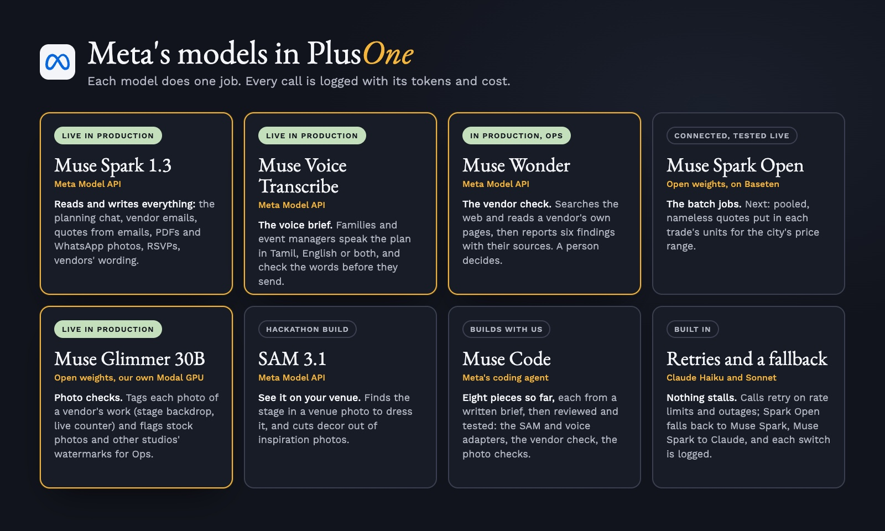
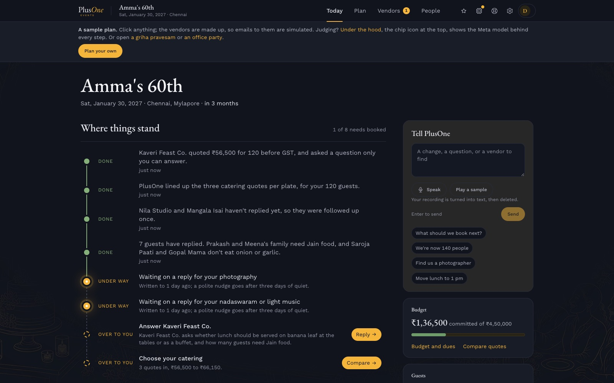
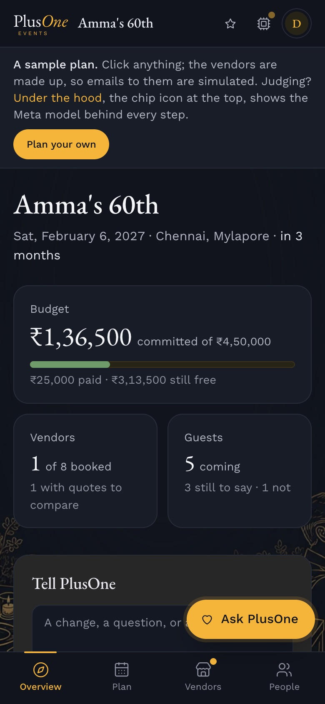
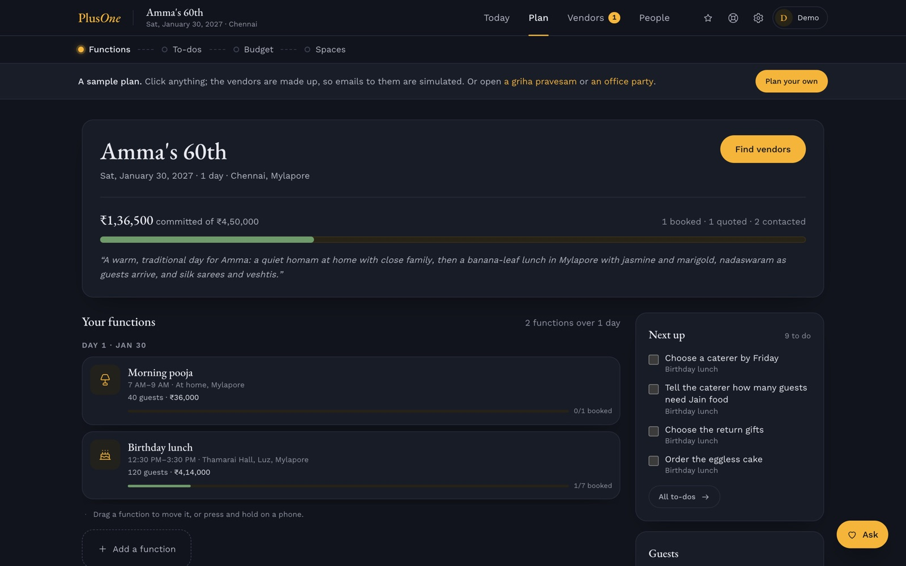
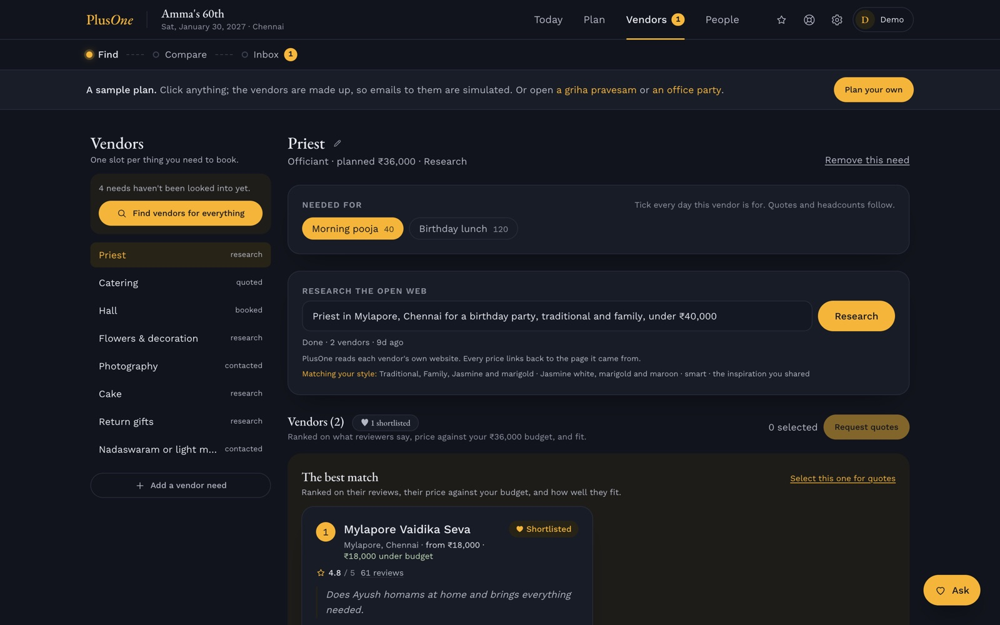
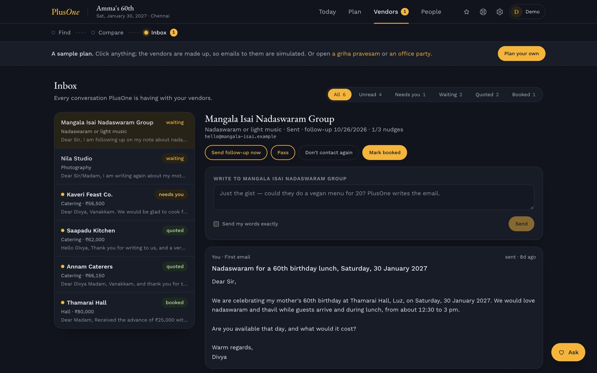
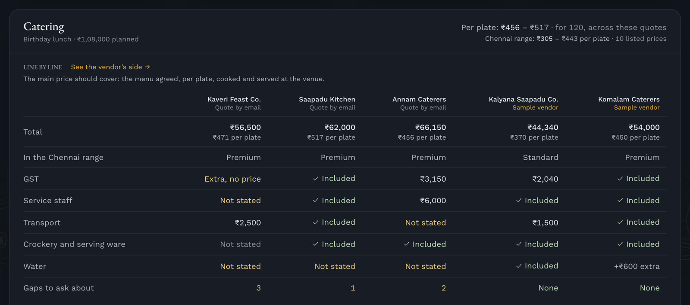
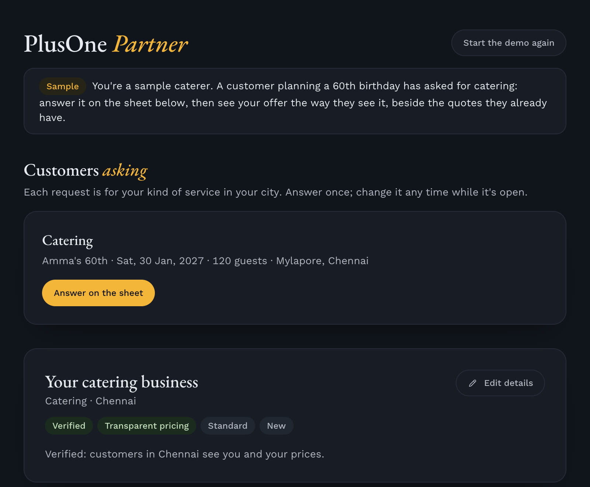
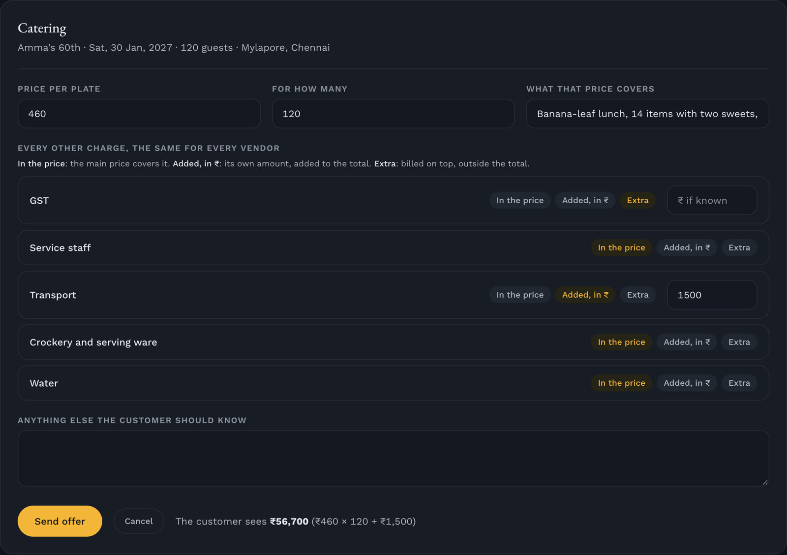

<div align="center">


# PlusOne Events

[](https://plusoneevents.site)
[](#for-the-judges)
[](https://app.plusoneevents.site/demo)
[](#metas-models-in-plusone)
[](#how-it-works)
[](#run-it-yourself)
[](#real-runs)


[](LICENSE.md)

<table align="center">
<tr>
<td align="center" width="168"><br><b>Meta Muse Spark</b><br><sub>Reads every quote, reply and PDF into the same lines; writes the plans and emails.</sub></td>
<td align="center" width="168"><br><b>Muse Glimmer</b><br><sub>Open weights on our own Modal GPU: checks and tags photos of vendors' work.</sub></td>
<td align="center" width="168"><br><b>Convex</b><br><sub>Database, functions, workflows, scheduling and webhooks in one.</sub></td>
<td align="center" width="168"><br><b>Claude</b><br><sub>The fallback for any call Meta can't answer, so nothing stalls.</sub></td>
<td align="center" width="168"><br><b>Firecrawl</b><br><sub>Reads vendors' own websites, down to their pricing pages.</sub></td>
</tr>
<tr>
<td align="center" width="168"><br><b>AgentMail</b><br><sub>Every event gets its own inbox to write to vendors from.</sub></td>
<td align="center" width="168"><br><b>Clerk</b><br><sub>One account for customers, vendors and staff, with a door for each.</sub></td>
<td align="center" width="168"><br><b>Resend</b><br><sub>The app's own email: the weekly update and account mail.</sub></td>
<td align="center" width="168"><br><b>PostHog</b><br><sub>Usage counts, never what people write, only with consent.</sub></td>
<td align="center" width="168"><br><b>Cloudflare</b><br><sub>Serves the site fast from India and everywhere else.</sub></td>
</tr>
</table>


</div>

> **We're building a standardised way to plan and buy events in India, where customers often struggle to compare quotes, understand what's included and coordinate fragmented vendors. AI turns the planning process into a structured, transparent workflow.**

Planning an event means juggling: vendors on calls and WhatsApp, quotes in email and PDFs, the budget in a spreadsheet, the guests in another list. And no two quotes are written alike, so nobody can tell what's included until the extra charges arrive. PlusOne solves both:

1. **One app instead of many tools.** An all-in-one, AI-powered event planner: the plan and its budget, vendors found and written to, every reply read and chased, guests, RSVPs and the event page, for an event of any size.
2. **Quotes you can compare, and vendors you can find.** Every quote and every vendor's offer lands on the same lines, so what's included, what's extra and what's missing is plain, along with where each price sits in the market. Vendors with no website or listing get a place to be found, and answer customers on those same lines.

The aim is to standardise a segment of the market, how events are planned and bought, so that every event gets a clear budget, comparable vendor options, transparent pricing and a predictable way to get it done, whatever its size: a first birthday as much as a wedding.

PlusOne is one platform with three layers that feed each other:

| Layer | For | What it does | Today |
|---|---|---|---|
| **PlusOne Basic** | Families and teams planning their own event, and event managers planning for their clients | Plans with you, finds vendors on the open web, writes to them from the event's own inbox, chases them, reads their quotes and lines them up in one unit, and keeps the budget. The host makes every decision | Live, free until launch |
| **PlusOne Premium** | People who want a person beside them | Everything in Basic, plus a real person from the PlusOne team helping in real time and on call | Opens after launch |
| **PlusOne Partner** | Vendors, including the many with no website or listing | Register, price packages in the units customers compare, answer a customer's brief, get verified and get found | Built during the hackathon, live since 28 Oct; voice sign-up next |

More vendors on Partner widen what customers can find and compare; more customers bring vendors work; and every quote read into the same lines sharpens the comparison and the market range for the next event.

It is built for the events families and teams actually hold: birthdays and sixtieths, housewarmings and griha pravesams, naming ceremonies, poojas at home, baby showers, anniversaries and engagements; office parties, team offsites, product launches, conferences, college fests and community festivals. Weddings are one of the sixteen types too.

Try it at [app.plusoneevents.site/demo](https://app.plusoneevents.site/demo), with no sign-up. Three sample events open there, all in rupees: Amma's 60th birthday (the default), a griha pravesam (`/demo?sample=housewarming`) and an office Diwali party with no alcohol (`/demo?sample=office`). Their vendors are made up, so nothing is really sent.

PlusOne began as a wedding planner and placed second at Convex's All Gas hackathon in September 2026. For the Meta Global AI Developer Hackathon (Startup track), it moves onto Meta's models and gains the pieces that make prices comparable at the source: [what's new is listed below](#for-the-judges).

**Team:** Padmanabhan Rajendrakumar (representative), who builds the core product and its move to Meta's models, and Sharmila Raghu, who builds PlusOne Partner and refines the design of every app. The two of them founded PlusOne.

## For the judges

**Try it in two minutes.** [The demo](https://app.plusoneevents.site/demo) opens Amma's 60th with no sign-up. Start on **Today**. Follow **Vendors → Compare**: three caterers' emailed quotes and two verified vendors' offers sit line by line on the same sheet, with what each leaves out flagged ("No water line, and one other charges ₹600") and the city's price range beside them. Then try the vendors' side, a demo of its own: [PlusOne Partner's demo](https://app.plusoneevents.site/partner/demo) opens as a sample caterer with a customer's catering request to answer on the same sheet, and once the offer is sent, shows it the way the customer sees it, line by line beside their quotes. Press **Under the hood** in the top bar to see each step's Meta model, time and cost, and type "We're now 140 people" in the box on Today to watch one run.

### The theme: Build for Your World

> "Bring Meta's models into your domain. Solve a problem you know firsthand, free up time and mental space, and make something possible that wasn't before."

| The theme asks | PlusOne's answer |
|---|---|
| **Bring Meta's models into your domain** | Event planning, on Meta's models end to end. Muse Spark reads replies, quotes and PDFs that mix Tamil and English into the same lines, and Muse Voice Transcribe hears a plan spoken in Tamil, English or both, both live today. Muse Wonder checks a vendor's evidence in Ops, and Muse Spark Open, open weights on Baseten, is connected for the batch jobs. Muse Glimmer, open weights on our own Modal GPU, checks and tags photos of vendors' work, live in production. Being added during the hackathon: SAM 3.1 on the customer's own venue photo |
| **A problem you know firsthand** | The founders know it from planning events in their own families: vendors spread across calls, chats and spreadsheets, quotes that can't be compared, charges that turn up later. PlusOne began as a planner for exactly that |
| **Free up time and mental space** | PlusOne does the legwork: it searches, writes from the event's own inbox, chases vendors up to three times, reads every reply and PDF into one unit and says what each quote leaves out. The host only decides |
| **Make something possible that wasn't before** | A family planning a birthday gets what only a wedding with a planner got before: offers in the same lines, missing charges flagged and the market range. An event manager gets the same for every client's event, without chasing each vendor by phone. A vendor with no website gets found and answers briefs. A plan can be spoken in Tamil, and the decor seen on the real hall before anyone pays |

### Built during the hackathon (27 Oct – 4 Nov 2026)

| What | Meta model | Status |
|---|---|---|
| Every reading and writing step moved to Meta's models, through one wrapper with retries, a logged fallback and a cost row for every call | Muse Spark 1.3 | Live in production, 27 Oct |
| **Under the hood:** every step PlusOne ran for an event, with its model, time and cost; in the demo, a recorded Muse Spark run on its own three catering quotes (28 Oct: all three read right, 7–14 s each, $0.033 in all), labelled as recorded | Muse Spark 1.3 | Live, 27 Oct; recorded run 28 Oct |
| The assistant changes the plan when told ("we're now 140 people", "move lunch to 1 pm"), as a card the host presses | Muse Spark 1.3 | Live, 27 Oct |
| The planning conversation asks what the event is called rather than who hosts it; pricing for the two plans (Basic and Premium since 28 Oct); a redesigned site | Muse Spark 1.3 | Live, 27 Oct |
| **The standard sheet:** what a quote must state for each kind of vendor (the unit, what's included, GST, transport, service, setup, overtime), shared by customers and vendors | Muse Spark reads each quote into it; fixed, tested rules do the rest | Live, 28 Oct (`convex/lib/standardSheet.ts`) |
| **Missing charges flagged** against the sheet and the other quotes, and **Compare line by line** with the city's market range | Muse Spark reads the quotes; the gaps and the range are fixed, tested rules | Live, 28 Oct: missing charges, line by line, and each city's range from vendors' listed prices |
| **A quote sent on WhatsApp:** add a photo or screenshot of a vendor's price list, a PDF or their pasted message, and it is read into the same lines as an emailed quote, landing in Compare | Muse Spark 1.3 (the photo goes in as an image) | Live, 28 Oct (`convex/sharedQuotes.ts`) |
| **The voice brief:** speak the plan in Tamil, English or both | Muse Voice Transcribe, Muse Spark | Live in production, 28 Oct: a microphone in the planning chat and the Today box; the words land in the box to check and send, and the recording is deleted once read. Built by Muse Code (`convex/voiceBrief.ts`, `src/components/VoiceButton.tsx`, with the encoder and adapter in `convex/lib/wav.ts` and `convex/lib/voice.ts`) |
| **See it on your venue:** tap the stage in a venue photo and see the decor on the real space | SAM 3.1 | Adapter built and tested (`convex/lib/sam.ts`); the view by 1 Nov |
| **PlusOne Partner:** vendors register, price packages on the standard sheet and answer a customer's brief | Voice sign-up: Muse Voice Transcribe, Muse Spark | Live, 28 Oct: its own sign-in, joining or claiming a listing, prices and offers on the standard sheet in each trade's own units with what's in the price, offers landing in the customer's Compare, their wording tidied before customers see it ("rs.500/-" becomes "₹500", never a changed number, the vendor chooses), and a vendors' demo of its own, separate from the customers'; its own address, partner.plusoneevents.site, built and going live; voice sign-up by 1 Nov |
| **PlusOne Ops:** a verification agent gathers evidence about a vendor, with links; a person decides | Muse Wonder | Review queue with its checklist, evidence and decisions live 28 Oct; the Muse Wonder check built into it 28 Oct ("Check this vendor", `convex/marketplace/checks.ts`), first live run next |
| **Photos of a vendor's work, checked:** real work or stock, another business's watermark, faces, and tags from a fixed list for the trade; flags go to Ops | Muse Glimmer 30B (open weights, our own Modal endpoint), Muse Spark as fallback | Live in production, 29 Oct |
| WhatsApp and calling vendors from the app | | Building, by 1 Nov |

Before the hackathon, PlusOne already planned an event from a conversation, found vendors, wrote to them from the event's inbox and put their quotes in one unit, on Claude. [Repository](#repository) gives the exact line between the two.

### How each criterion is met

| Criterion (weight) | What PlusOne shows | Where to look |
|---|---|---|
| **Impact (30%)**: real-world potential, who benefits, could people use it, fit to the problem statement | **The pain:** planning is spread across calls, chats, email and spreadsheets, and no two quotes are written alike, so charges turn up late. **Who benefits:** families, teams and event managers planning events of any size, and vendors with no website or listing, who can't be found. **What PlusOne does:** one all-in-one app for the whole plan, and every quote and offer on the same lines, with missing charges flagged and the market range. **Real-world potential:** every event needs vendors and quotes, at every budget; the aim is to standardise how they are planned and bought, with four revenue streams. **Could people use it:** it is live at plusoneevents.site, free until launch, with a guest demo that needs no sign-up. **Fit:** Build for Your World, answered row by row above | [The business](#the-business), [How it works](#how-it-works) |
| **Use of Meta AI tooling (25%)**: creative, beyond a basic integration, surprising capabilities | Each model does the job it is best at, chained into one flow. Today, Muse Spark reads every reply, PDF, quote and WhatsApp photo of a price list, in Tamil and English, into the same lines, and fixed rules then flag what each leaves out; Muse Voice Transcribe hears a spoken brief and Muse Spark turns it into the plan. Muse Wonder gathers evidence about a vendor for Ops, with its sources. Muse Spark Open, open weights on Baseten, is connected and tested live, and takes Muse Spark's place for batch jobs. Muse Glimmer, open weights on our own Modal GPU, checks and tags photos of vendors' work. Being added: SAM 3.1 finds the stage in a venue photo for the decor. Muse Code builds pieces of the app. Every call shows in Under the hood with its model, time and cost. Each piece's status is in the table above | [Meta's models in PlusOne](#metas-models-in-plusone) |
| **Technical depth and execution (20%)**: sound, refined engineering, real craft | The model reads; fixed, tested rules decide what to ask next, when a plan is ready, when a quote may move the budget and what a quote leaves out. One wrapper sends structured output checked against Zod schemas, retries that honour `Retry-After`, falls back with a log and writes a cost row per call. Durable workflows, scheduling, webhooks and rate limits run on Convex, with 588 tests | [The tech, part by part](#the-tech-part-by-part), [Real runs](#real-runs) |
| **Demo (25%)**: working, impressive, holds up live, a video worth watching | A live guest demo with no sign-up and three sample events. It holds up live with retries, a fallback, rate limits and made-up vendors, so nothing is really sent. A three-minute video of the new work | [The demo](https://app.plusoneevents.site/demo) |

## The business

| Stream | How it works | Status |
|---|---|---|
| **Basic** subscription | The planner app does the legwork; the host decides | Free until launch, then ₹1,000 or $10 a month ([pricing](https://plusoneevents.site/pricing)) |
| **Premium** planning | A real person from the PlusOne team plans with you, in real time and on call | ₹2,500 or $25 a month, after launch |
| **Booking fee** | A disclosed fee on bookings completed through PlusOne | Planned, with booking in the app |
| **Vendor subscription** | Partner tools for vendors: quotations, leads, scheduling and analytics | Planned; listing is free first |

Every fee is disclosed. Fair pricing here means informed and comparable: PlusOne shows each price itemised, beside the others and the market range. It never sets one price for everyone or picks the cheapest bid by default. For now, customers pay vendors directly.

## Meta's models in PlusOne



| Model | Where it works in PlusOne | Status |
|---|---|---|
| **Muse Spark 1.3** (Meta Model API) | Every reading and writing step: the planning conversation, search plans and vendor ranking, inquiries and follow-ups, quotes in replies and PDFs, RSVPs, guest-list imports, palettes and the "Tell PlusOne" box. Structured answers come back as JSON Schema, checked against the same Zod schemas | Live in production since 27 Oct 2026 |
| **Muse Voice Transcribe** | The voice brief: a family or an event manager speaks the plan in Tamil, English or both, in the planning chat or the Today box; next, a vendor talks through what they offer | Live in production since 28 Oct 2026 |
| **SAM 3.1** | Cuts the stage, florals and lights out of inspiration photos for the decorators' brief, and finds the stage in a venue photo to dress it | Adapter built and tested (`convex/lib/sam.ts`: one concept or up to 16 tapped objects, masks read with `@meta-sam/parser`); the venue view is next |
| **Muse Wonder** | The verification agent in PlusOne Ops: checks a vendor's profile against their own site and public pages, with links; a person decides | Built into Ops, 28 Oct (`convex/lib/wonder.ts`, `convex/marketplace/checks.ts`): web search and page reads, six findings, a source kept only if the run saw it; first live run next |
| **Muse Spark Open** (open weights, on Baseten) | Batch jobs over quotes and listings: first, turning pooled quotes into the standard sheet's units for the city's price range; then seeding the vendor directory from public listings | Connected and tested live, 29 Oct (`convex/lib/sparkOpen.ts`): a photographer's shorthand quote read into the right numbers in 2.8 s; a call Baseten can't answer goes to Muse Spark. Its first feature is next |
| **Muse Glimmer 30B** (open weights, on our own Modal endpoint) | Checks each photo a Partner vendor adds of their work: real event work or stock, another business's name or watermark, faces, anything unsafe, what it shows, and up to five tags from a fixed list for the trade (stage backdrop, entrance arch, banana-leaf service, live counter); flags go to Ops, where a person decides | Live in production, 29 Oct (`convex/lib/glimmer.ts`, `convex/marketplace/photos.ts`): one H200 that scales to zero; on the live vendors' demo a caterer's photo was checked in about 6 s warm and tagged plated service and serving staff, after a cold start of about 3.6 minutes; a check it can't finish goes to Muse Spark |
| **Muse Code** (Meta's coding agent) | Builds bounded pieces of PlusOne from a written brief, which are then reviewed and tested before they are committed; eight sessions so far: the SAM 3.1 adapter, the voice brief (its audio encoder, the Voice Transcribe adapter and the brief in the app), the Muse Wonder vendor check and its place in Ops, the tidy for vendors' wording, and the Glimmer photo checks. Every session is logged in [`devlog.md`](devlog.md#muse-code) | In use since 27 Oct 2026 |

**See it at work:** in any event, the **Under the hood** button in the top bar lists every step PlusOne ran for that event, with the Meta model that did it, how long it took and what it cost. In the demo it opens on a recorded run: Muse Spark reading the three caterers' replies into the lines Compare shows. Ask "We're now 140 people" on Today and watch a new step appear.

Every call goes through one wrapper, `convex/lib/models.ts`. `MODEL_PROVIDER=meta` with a Model API key sends it to Meta; calls retry on 429, 500 and 503, honouring `Retry-After`, and a call Meta can't answer moves to Claude, with the switch logged. A request Meta rejects as malformed is raised, not hidden. Every call writes a row to `modelCalls` with its feature, model, tokens and list-price cost, so spend is known per feature and per day.

## How it works

One app, two sides working on the same lines: customers plan and compare, vendors answer, and the PlusOne team checks every vendor before customers see them.


### Planning an event

For families, teams and event managers.

1. **Talk it through.** "Amma's 60th, a homam at home and lunch for about 120." PlusOne asks for what it still needs, one thing at a time, reads it all back and flags anything that can't be right, like a weekday that doesn't match the date. The model reads each message; fixed rules decide what to ask next and when the plan is ready (`/new`, `convex/planningChat.ts`). A form at `/new/manual` does the same step by step.
2. **Open on Today.** PlusOne's route through the event: what is done, under way, over to you and up next, each with the button that finishes it (`src/pages/TodayPage.tsx`). A box beside it takes a change in plain words: "we're now 140 people".



3. **Everything in one place.** Four lanes, Today, Plan, Vendors and People, hold the functions, to-dos, budget, vendors, inbox, guests, gifts and the event page, so nothing lives in a separate spreadsheet or chat (`src/components/EventLayout.tsx`). The words follow the event: functions and guests for a birthday, sessions and attendees for a conference.

<table>
<tr>
<td width="30%" valign="top"></td>
<td valign="top"><br><sub>On a phone the four lanes move to a bar along the bottom. On a laptop, the Plan lane: the event, the money committed so far, its two functions and what to do next.</sub></td>
</tr>
</table>

4. **Find vendors two ways.** PlusOne searches the open web, reads vendors' own sites down to their pricing pages and ranks what it finds with a reason for each, every price linked to its page. Or press **Ask verified vendors** on a need, and vendors on PlusOne Partner answer it.
5. **Write from the event's own inbox.** PlusOne sends the inquiries from the event's address, follows up with vendors who go quiet (up to three times) and answers simple questions. Anything that is the host's to decide comes back as one clear question.

| Vendors found on the open web | The event's inbox |
|---|---|
|  |  |

6. **Every quote on the same lines.** An emailed reply, a PDF, a photo of a price list sent on WhatsApp or a pasted message is read into the standard sheet for that kind of vendor: the unit, what's included, GST, transport, service and the usual extras (`convex/lib/standardSheet.ts`, `convex/sharedQuotes.ts`).
7. **Compare line by line.** Quotes and verified vendors' offers sit side by side in the same unit at the host's own headcount, with what each leaves unsaid flagged ("No water line, and one other charges ₹600") and where each sits in the city's price range, and a "What's in it" block that shows what each price includes (hours, photographers, dishes), with the lower ones marked (`src/pages/DecisionsPage.tsx`, `convex/lib/comparable.ts`).



8. **Keep the budget honest.** A quote moves the budget by itself, with an undo; one that looks off (another currency, a price far from the plan) waits for the host. Every deposit, balance and vendor deadline sits in one list that can go to a calendar.
9. **Guests and the event page.** Each guest gets an invitation and their own RSVP link, and replies are saved for each function with head counts and food needs. The event page is written from the plan, and the plan can go to family or colleagues as a read-only link, or print on one page.

### Answering as a vendor

On PlusOne Partner, for vendors, including the many with no website or listing. It has its own demo, separate from the customers': [try it as a sample caterer](https://app.plusoneevents.site/partner/demo), with no sign-up, answering a customer's catering request and then seeing the offer the way the customer does.

1. **Get listed.** Set up the business, or claim the listing PlusOne already made from its public pages. A person at PlusOne checks it is real, usually within a day, and customers see it after that.
2. **Price it the way the trade does.** Each package is priced as that trade charges (per plate, for the event, per hour, per kg, per session) with what's in it (hours of coverage, photographers, edited photos, dishes, delivery), and the vendor sees the exact line customers will read. Itemised prices earn the Transparent pricing badge and count towards the city's range, never with the vendor's name on them.
3. **Answer customers' requests.** Each request is for the vendor's kind of service in their city: the occasion, date, guests and area, never the customer's name, contact or budget. The vendor answers every line of the same sheet, in the price, added in ₹ or extra, and sees the total the customer will see before sending.
4. **Land in the customer's Compare.** The offer sits beside the customer's other quotes, line by line. It can be changed or withdrawn while the request is open, and a vendor's level grows with events done through PlusOne: New, Trusted after 3, Top after 10.

| The vendor's page | Answering a customer's request |
|---|---|
|  |  |

### Checking vendors

PlusOne Ops, at `/ops`, is the PlusOne team's side. A queue holds vendors and listing claims waiting for a check; each vendor's page shows the evidence, and a person verifies, turns down or pauses, kept as an append-only record of who decided what on what evidence. "Check this vendor" runs a Muse Wonder check first: it searches the web and reads the vendor's own pages, then lists six findings (the business exists, the website is theirs, contact details, where they work, prices, complaints), each with the pages behind it, above the reviewer's checklist. It never ticks the checklist; a person decides. Partner's pages, backend and rules: [`src/partner/README.md`](src/partner/README.md).

### The rest of the app

- **Spaces**, one open board per event to pan and zoom, with a zone for each function or session: pictures, links from Instagram, Pinterest, TikTok or any page, notes, colour swatches and pinned vendors, with palettes suggested from the pictures.
- **People planning together:** owner, planner and viewer roles, with single-use invite links that can be revoked.
- **Emails from PlusOne:** a weekly update on Fridays that skips quiet weeks, with a way to stop it.
- **A guided tour**, "Show me around", that points at the real controls on each page.
- **Dark ink and marigold by default**, with a light theme of ink blue on ivory; pick Light, Dark or Device, and the choice carries between the home page and the app. The same line drawing, marigold at night and a soft blue by day, frames the home page, sign-in and the public pages, and sits faintly behind the app; the home page moves gently, with the hero rising in and sections rising into view. A new event's currency, and the home page's example, follow where the visitor is, so money shows in rupees in India and dollars in the US.
- **Pricing**, at [/pricing](https://plusoneevents.site/pricing): Basic is free to use until launch, then ₹1,000 or $10 a month; Premium, where a person from the PlusOne team plans with you and is on call any time, opens after launch at ₹2,500 or $25 a month (`src/pages/PricingPage.tsx`, prices in `src/lib/pricing.ts`).
- **It installs on a phone like an app**, and a link shared to it from another app lands in a Space.

## Care taken

- **The host stays in charge.** PlusOne never books, pays or signs. It drafts, sends and chases; every decision is the host's.
- **Nobody is pestered.** Follow-ups stop after three. A vendor who asks not to be contacted is never written to again, by any event, and first emails say how to stop them.
- **Every number has a source.** Prices link to the vendor's page or the reply they came from, and a per-plate figure is shown only when the quote's lines add up.
- **A misread price never moves the budget by itself.** Quotes that look off wait for the host, and the rest can be undone.
- **Model spend is counted, not guessed.** Every model call records its model, tokens and cost, never the prompt or the answer.
- **Usage is measured without reading what people write.** Usage events carry names and safe numbers only, stay off until a key is set, and in the browser start only once the visitor allows them.
- **Guest pages stay private.** The event page, RSVP links and shared plans use long random addresses, ask search engines not to list them, and show only the fields they need.
- **Vendors' sites are read politely.** Search obeys each site's robots.txt, never reads listing or review sites, and keeps no reviewer quotes; rankings and top picks are labelled as PlusOne's estimate.
- **Data is the host's to remove.** An event can be deleted from its settings and an account from the account page, with the files, chats and visit logs they left and the sign-in account itself.
- **The demo is safe to click.** Its vendors are made up and its emails are simulated, never sent; each demo visitor gets a fresh sample of their own, with tighter rate limits.

## Real runs

| What | Result | When | How |
|---|---|---|---|
| Muse Spark in production | A made-up guest reply ("Both of us will come. My husband is allergic to peanuts.") read by `muse-spark-1.3` through the production backend: coming, 2 people, the peanut allergy caught, valid structured output first time; 1,214 tokens in, 880 out, $0.0053, written to `modelCalls` | 27 Oct 2026 | `npx convex run claude:readRsvpReply` against production |
| Muse Spark reading the demo's quotes | The three caterers' replies read on `muse-spark-1.3` in production, each right first time: Annam ₹66,150 in three lines (150 plates at ₹380, ₹6,000 service, ₹3,150 GST), priced for 150; Saapadu ₹62,000 all in for 120 with the ₹480 extra plate kept apart; Kaveri ₹54,000 plus ₹2,500 for vessels and staff, GST extra. 7.1–14.4 s each, 4,329 tokens in and 6,570 out, $0.033 in all, no fallback | 28 Oct 2026 | `npx convex run claude:readDemoQuotes`; the rows are Under the hood's recorded run |
| Muse Voice Transcribe in production | A note spoken into the live app's Today box came back as text in the box, first try; the recording was deleted after reading | 28 Oct 2026 | By hand on app.plusoneevents.site, in the founder's own voice |
| Muse Spark's reasoning | At `reasoning_effort: low` a one-line reply used 194 reasoning tokens; capped at 400 output tokens, reasoning took 398 and the answer came back empty. Every call site allows 16,000 | 27 Oct 2026 | Two direct Chat Completions calls |
| Tests | 622 passed in 58 files, including the quote comparison, the standard sheet and its missing-charge rules (pinned on the guest demo's quotes), the marketplace's listings, briefs, offers and price ranges, the Meta provider switch and its fallback, Muse Spark Open on Baseten and its move to Muse Spark, the photo checks on Muse Glimmer (its retries through a cold start, the tag list, the limits and the Ops decisions), the cost record, the voice brief's limits and clean-up, the vendor check's tool loop, source rules, limits and cost on failure, the planning conversation's rules, the board's geometry, the co-pilot's route and a contrast check of every text colour in the light and dark themes | 29 Oct 2026 | `npm test` |
| Typecheck, app and backend | Clean | 28 Oct 2026 | `npm run typecheck` |
| The three sample events | Each opened from `/demo` for a new visitor (the birthday, `?sample=housewarming`, `?sample=office`); eleven screens captured with 0 page errors; at phone width (390 px) the page is exactly as wide as the screen, with no sideways scroll | 25 Oct 2026 | Headless Chrome (playwright-core) against the dev server and the dev backend; these are the screenshots in this README |
| Vendor search terms, old against new | Vendors' own websites among results kept: 9 of 27 with the new short terms against 5 of 26 with the old single sentence, for about half the credits | 20 Oct 2026 | A one-off before/after run of three briefs against Firecrawl |
| Page load from India | First byte in 0.08–0.09 s from Cloudflare's edge, down from 0.9–1.2 s | 18 Oct 2026 | `curl` timing from India |

## The tech, part by part

| Part | Built with | What it does |
|---|---|---|
| App | React 19, React Router 7, Vite 8, Tailwind CSS 4, dnd-kit, lucide-react, EB Garamond and Work Sans | Every screen, in `src/pages/` and `src/components/`; the four-lane top bar in `src/components/EventLayout.tsx`; the themes in `src/lib/theme.ts` and `src/index.css` |
| Backend and database | Convex 1.45, with the workflow, workpool, rate-limiter, action-cache and static-hosting components | Schema, queries, mutations, actions, crons and webhooks in `convex/` |
| The planning conversation | Muse Spark (fast tier) plus own rules | `convex/planningChat.ts` reads each message into facts; `convex/lib/planningChat.ts` decides what to fix, ask or read back and when the plan is ready; `convex/lib/wizard.ts` fills in defaults by event type from `convex/lib/templates.ts` and turns the result into an event; the page is `src/pages/NewEventPage.tsx` |
| Event types | Own code | Sixteen types in three groups (family, work and community, other), with the words each one uses, in `convex/lib/occasion.ts` |
| Today | Own code, no model | PlusOne's route for the event in `convex/copilot.ts`, drawn by `src/pages/TodayPage.tsx`; the "Tell PlusOne" box goes to `convex/assistant.ts`, and anything it proposes to change waits on a card until someone presses its button |
| Reading and writing | Meta's Muse Spark (`muse-spark-1.3`, Standard) through the Model API's Chat Completions, with structured output as JSON Schema; Claude (`claude-sonnet-5-5`, `claude-haiku-5-5`) as the fallback | `convex/lib/models.ts` picks the provider from `MODEL_PROVIDER`, sends one house style ahead of every request, retries Meta on 429/500/503, moves a call to Claude when Meta can't answer, and writes each call's tokens and list-price cost to `modelCalls`; adapters in `convex/lib/meta.ts` and `convex/lib/claude.ts` |
| Speaking the plan | Muse Voice Transcribe (`muse-voice-transcribe-1.0`) | The browser records and encodes a 16 kHz mono WAV (`src/components/VoiceButton.tsx`, `convex/lib/wav.ts`); `convex/voiceBrief.ts` checks the caller and their allowance, sends it with our customers' own words as hints (`convex/lib/voiceWords.ts`) through the adapter in `convex/lib/voice.ts`, deletes the recording once read and writes a cost row at $0.18 an hour, by the second. No fallback: if Meta can't hear it, the person types |
| Vendors' wording | Muse Spark (fast tier) plus own rules | `convex/marketplace/tidy.ts` tidies what a vendor writes in one call when they save; `convex/lib/tidy.ts` throws a tidy away if any number changed or it grew much longer, and points out phone numbers, emails and links left in free text; the vendor sees before and after in `src/partner/PartnerPage.tsx` and chooses. A failed tidy saves what they wrote |
| The vendor check in Ops | Muse Wonder (`muse-wonder-1.0`) on the Responses API, with its web search; pages read through Firecrawl | `convex/lib/wonder.ts` runs the tool loop (at most 8 searches, 6 pages and 6 turns a check) and keeps a source only if the run saw it; `convex/marketplace/checks.ts` runs it in the background, staff only, with daily limits, and writes the report and a cost row, even for a check that fails part way; `readPage` in `convex/firecrawl.ts` keeps to the same reading rules as vendor search; the panel is in `src/partner/OpsPage.tsx` |
| Open weights on Baseten | Muse Spark Open (`meta-models/muse-spark-open-1026`) through Baseten's Chat Completions, paid from Baseten's credit | `convex/lib/sparkOpen.ts`; the same request and reply code as Meta's API (`chatBody` and `chatComplete` in `convex/lib/meta.ts`), so structured output and retries match; a call asks for it with `provider: "spark_open"` and moves to Muse Spark when Baseten can't answer; `convex/openWeights.ts` is a hand-run live check |
| Photos of a vendor's work | Muse Glimmer 30B on our own Modal Dedicated Endpoint (one H200, SGLang, OpenAI-compatible), Muse Spark as fallback | Partner shrinks a photo in the browser and uploads it; `convex/marketplace/photos.ts` checks it in the background; `convex/lib/glimmer.ts` sends it with a proxy token, retries while the GPU starts and ends within seven minutes; `convex/lib/photoTags.ts` holds the tags per trade and the plain-words flags; Ops approves or removes |
| Cost record | Own code | `convex/modelCalls.ts` writes one row per model call; prices per million tokens for Muse Spark, Muse Wonder, Muse Spark Open on Baseten and the Claude fallback in `convex/lib/modelCost.ts`. The row is written before the answer is checked, since an answer that fails validation was still paid for |
| Vendor search | Firecrawl | Short search terms in `convex/lib/searchTerms.ts`; research, ranking and contact and pricing pages in `convex/research.ts` and `convex/firecrawl.ts`, with what may be read decided in `convex/lib/scrapePolicy.ts` and a cache in `convex/webCache.ts` |
| The event's inbox | AgentMail | One inbox per event, named after the hosts' first names on the deployment's domain, in `convex/agentmail.ts` and `convex/lib/inboxName.ts`; sending, replies and follow-ups in `convex/outreach.ts`, `convex/inbound.ts` and `convex/followups.ts`; the do-not-contact list in `convex/doNotContact.ts`. Each deployment keeps its inboxes in its own AgentMail pod, with a webhook that hears only that pod |
| Quotes in one unit | Own code | `convex/lib/comparable.ts` puts each quote per plate, per piece, per day or all in, at the host's numbers, with its flags; `convex/quotes.ts` and `convex/lib/quoteHold.ts` decide when a quote waits and handle the undo; the page is `src/pages/DecisionsPage.tsx` |
| Budget, dues and currencies | Own code | `convex/budget.ts` and `convex/dues.ts`; the calendar file is made in the browser by `src/lib/calendar.ts`; currency by region in `src/lib/currency.ts` and `src/lib/region.ts` |
| Sample events | Own code | `convex/demoBirthday.ts`, `convex/demoHousewarming.ts` and `convex/demoOfficeParty.ts`, started fresh for each visitor by `convex/demo.ts` and `src/pages/GuestPage.tsx` |
| Sign-in | Clerk, with Convex Auth for the demo | Accounts sign in with Clerk in `src/lib/session.tsx` and `src/pages/SignInPage.tsx`; the first sign-in finds an earlier account by its verified email, in `convex/users.ts`. Demo visitors get short-lived guest tokens from Convex Auth (`convex/auth.ts`), so the demo needs no account |
| Guests, event page and gifts | Own code | Guests and RSVPs in `convex/guests.ts` and `convex/lib/rsvp.ts`; the event page in `convex/site.ts` with `src/pages/SitePage.tsx` and `src/pages/RsvpPage.tsx`; gifts in `convex/gifts.ts` |
| Spaces | Own code, plus TikTok, Pinterest and YouTube previews and any page's own tags | The board in `src/components/board/Board.tsx`, with its geometry in `src/lib/board.ts`; `convex/spaces.ts` for pictures, links, notes, swatches, pinned vendors, previews and palettes (suggested by Muse Spark), with `convex/lib/links.ts`, which refuses private addresses; the phone share target in `public/manifest.webmanifest`, landing in `src/pages/SharePage.tsx` |
| Sharing, import and export | Own code, fflate for spreadsheets, plus Muse Spark | Read-only links in `convex/shareLinks.ts`, the one-page plan in `src/components/PlanSheet.tsx`, the full download in `convex/exports.ts`; guest-list imports in `convex/guestImport.ts` |
| App emails | Resend, via the Convex component | The weekly update in `convex/digest.ts`, sent Fridays by `convex/crons.ts`, through the Resend client in `convex/appEmails.ts`; the +1 logo for mail apps that show one in `public/bimi.svg` |
| Usage | PostHog | Counts what people do, never what they write, in `convex/analytics.ts` and `src/lib/analytics/`; it starts only after a visitor allows analytics on the consent bar (`src/components/ConsentBar.tsx`), with session recordings off, and `functions/ingest/` forwards events without the visitor's IP address |
| Hosting | Cloudflare Pages and a Worker, Convex in Ireland | The built app is served from Cloudflare's edge on plusoneevents.site (home) and app.plusoneevents.site (app); `src/lib/hosts.ts` keeps each page on its own address, and `functions/geo.ts` says which country and state a visit comes from. The backend runs on Convex in Europe (Ireland) |

Rate limits on searches, emails, invites, sign-ups, planning conversations, imports, links added to Spaces, palettes, RSVPs, gifts and the assistant are in `convex/rateLimits.ts`, with tighter limits for demo visitors and a daily ceiling across all events for research, the assistant and drafting.

## Run it yourself

You need Node 20 or later, a Convex account and a Clerk application with a JWT template named `convex` (claims `aud: convex`, `name`, `email`, `email_verified`).

```bash
git clone https://github.com/pe-hq-alpha/plusone-app.git plusone && cd plusone
npm install
npx convex dev --once     # first run: sign in and create a dev deployment (writes .env.local)
node scripts/auth-keys.mjs                                   # once: JWT_PRIVATE_KEY and JWKS for the demo's guest tokens
npx convex env set SITE_URL http://localhost:5173            # where links in emails point
npx convex env set CLERK_JWT_ISSUER_DOMAIN https://<your-clerk-frontend-api>
npx convex env set MODEL_PROVIDER meta && npx convex env set MODEL_API_KEY <meta-key>   # or ANTHROPIC_API_KEY
echo 'VITE_CLERK_PUBLISHABLE_KEY=pk_test_…' >> .env.local     # the app's Clerk key
npm run dev               # the app on http://localhost:5173, and the backend watching for changes
```

Open `http://localhost:5173/demo` for the sample events; they need only the steps above, since their vendors are made up and nothing is sent. Vendor search also needs `FIRECRAWL_API_KEY`, and real emails need the AgentMail and Resend keys in the table below.

Or run `./start.sh`, which checks Node, installs what's missing, warns about any backend key not yet set on the deployment, and then starts both.

Backend keys are set on the deployment, for example `npx convex env set ANTHROPIC_API_KEY …`, never in a file. **To run on Meta's models**, also set `npx convex env set MODEL_PROVIDER meta` and `npx convex env set MODEL_API_KEY …` (a Meta Model API key); without them every call runs on Claude. The minimum to try it is what the block above sets. To deploy (run `node scripts/auth-keys.mjs --prod` once for the production deployment first):

```bash
npx convex deploy -y                                                    # the backend
VITE_CONVEX_URL=https://<deployment>.convex.cloud \
VITE_HOME_ORIGIN=https://<home> VITE_APP_ORIGIN=https://app.<home> VITE_PARTNER_ORIGIN=https://partner.<home> \
VITE_CLERK_PUBLISHABLE_KEY=pk_live_… npx vite build                     # the app, built against it
npx wrangler pages deploy dist --project-name <pages-project>          # served from Cloudflare Pages
node scripts/agentmail-setup.mjs https://<deployment>.convex.site <pod-id>   # once: the inbox webhook
```

The app can also be served by Convex itself: `npm run deploy`.

Every push to `main` runs typecheck and tests in CI. A staging workflow (`.github/workflows/staging.yml`) deploys each green push to a separate backend and site once its deploy keys are set as repository secrets; production is deployed by hand.

| Variable | For |
|---|---|
| `ANTHROPIC_API_KEY` | Claude: the fallback for every model call, and the provider when `MODEL_PROVIDER` isn't `meta` |
| `ANTHROPIC_MODEL_SMART`, `ANTHROPIC_MODEL_FAST` | Optional. Override `claude-sonnet-5-5` and `claude-haiku-5-5` |
| `MODEL_PROVIDER` | `meta` to run model calls on Meta's models; anything else (or unset) uses Claude |
| `MODEL_API_KEY` | Meta Model API key. Without it, `MODEL_PROVIDER=meta` falls back to Claude |
| `META_MODEL_SMART`, `META_MODEL_FAST` | Optional. Override `muse-spark-1.3` per tier (Contributor ids are refused) |
| `META_BASE_URL` | Optional. The Model API address, `https://api.meta.ai/v1` by default |
| `BASETEN_API_KEY` | Optional. Baseten key for Muse Spark Open; without it, calls that ask for Spark Open run on Muse Spark |
| `GLIMMER_BASE_URL`, `MODAL_PROXY_TOKEN` | Optional. Our Muse Glimmer endpoint on Modal and its proxy token (`wk-….ws-…`); without them, photo checks run on Muse Spark |
| `GLIMMER_MODEL` | Optional. The endpoint's model name, `inference-1` by default |
| `FIRECRAWL_API_KEY` | Vendor search |
| `AGENTMAIL_API_KEY`, `AGENTMAIL_WEBHOOK_SECRET`, `AGENTMAIL_INBOX_DOMAIN` | The event inboxes and their incoming mail |
| `AGENTMAIL_FALLBACK_INBOX_ID` | Optional. An inbox to use when an event can't get its own |
| `AGENTMAIL_INBOX_LIMIT` | Optional. How many inboxes the AgentMail plan allows, 3 by default |
| `AGENTMAIL_POD_ID` | Optional. The AgentMail pod this deployment keeps its inboxes in, so production and dev never share mail |
| `SITE_URL` | Links in emails back to the app |
| `CLERK_JWT_ISSUER_DOMAIN` | The Clerk instance whose sign-ins the backend accepts, such as `https://clerk.<home>` |
| `CLERK_SECRET_KEY` | Optional. Deletes the person at Clerk too when an account is deleted |
| `VISIT_LOG_SECRET` | Optional. Shared with the Cloudflare middleware, which sends each visit for the security log |
| `JWT_PRIVATE_KEY`, `JWKS` | Keys for the demo's guest tokens (Convex Auth), made by `node scripts/auth-keys.mjs` |
| `RESEND_API_KEY`, `EMAIL_FROM` | The app's own emails |
| `EMAIL_LIVE` | Optional. `1` to send app emails; anything else keeps them in test mode |
| `EMAIL_UNSUBSCRIBE_SECRET` | Signs the stop links in app emails |
| `POSTHOG_KEY`, `POSTHOG_HOST` | Optional. Usage events from the server |
| `VITE_CONVEX_URL` | The app's link to its backend (written by `npx convex dev`) |
| `VITE_CLERK_PUBLISHABLE_KEY` | The app's Clerk key: `pk_test_…` for development, `pk_live_…` for the live site |
| `VITE_POSTHOG_KEY`, `VITE_POSTHOG_HOST` | Optional. Usage events from the app |
| `VITE_HOME_ORIGIN`, `VITE_APP_ORIGIN`, `VITE_PARTNER_ORIGIN` | Optional. The home page's address, the app's and PlusOne Partner's; set them to split the three across their own addresses, or none to keep one, with Partner at `/partner` |

## Status and limits

Planning works end to end: the planning conversation, the plan, Today, vendor search, emails, replies, quotes on the same lines, verified vendors' offers, the budget and dues, guests and RSVPs, the event page, gifts, sharing, imports, Spaces, the weekly update and people planning together.

- Vendor search is only as good as vendors' own websites: a vendor with no prices online comes back without one, until it replies.
- A city's price range shows only once eight listed prices sit behind it; until then Compare shows the range across the event's own quotes. A price that cannot be put in the unit honestly is shown as quoted, not converted.

## Next steps

- **Finish the hackathon build:** the items marked "Building" in [For the judges](#for-the-judges), by 1 November.
- **Real customers and vendors:** families, teams, event managers and vendors on the events that repeat most (birthdays, engagements, housewarmings); real quotations collected and hidden charges mapped; then a hand-run pilot with paying customers, measuring cost per event, booking conversion, vendor response and referrals.
- **PlusOne Premium:** a real person from the PlusOne team beside the app, in real time and on call, opening after launch.
- **Booking and execution:** milestones, advances, vendor confirmations, change requests and a final reconciliation, booked through PlusOne with a disclosed fee.
- **Vendor reliability, measured:** punctuality, cancellations, quality and budget overruns, so customers know who delivers.
- **Billing:** Stripe outside India and Razorpay in India.
- **More cities, then more countries:** the same engine and playbook, adapted to local vendors, customs and prices.

## Repository

**History.** PlusOne Events is an early-stage startup being built in semi-stealth, so this repository starts from a snapshot of earlier private work rather than its full history. The first commit, tagged [`pre-hackathon`](../../tree/pre-hackathon) (26 October 2026, 14:58 IST), is the product as it stood before the hackathon. Kickoff was 26 October at 9:30 PM IST: eleven commits made that afternoon, before kickoff, are privacy and trust groundwork, and every commit from 27 October (`608627f`) on was made during the hackathon. [`devlog.md`](devlog.md) sets out each day's work. The earlier history is kept privately.


| Path | What it is |
|---|---|
| `src/pages/` | One file per screen: Today, the plan and each function, to-dos, budget, Spaces, Find, Compare, Inbox, guests, gifts, the event page, the planning team, settings and the new-event pages, plus the guest pages for the event page, RSVP links and shared plans |
| `src/partner/` | PlusOne Partner for vendors, with its own demo, and Ops (`/ops`) for the PlusOne team, with [its own README](src/partner/README.md) |
| `src/components/` | Shared pieces: the four-lane layout (`EventLayout.tsx`), the guided tour, the wordmark in `src/components/brand/` |
| `convex/` | The backend: `schema.ts` and one file per area, with tests beside them |
| `convex/marketplace/` | PlusOne Partner's backend: listings and claims, briefs and offers, Ops decisions, the vendor check and city price ranges |
| `convex/lib/` | Pure rules shared with the app: quote comparison, the standard sheet and its missing charges, the planning conversation's rules, event types and their words, templates, inbox names, search terms |
| `scripts/` | `auth-keys.mjs` makes the demo's guest-token keys; `agentmail-setup.mjs` registers a deployment's inbox webhook; `fake-webhook.mjs` sends a signed test email to it |
| `functions/` | Cloudflare Pages Functions: `geo.ts` for a visit's country and state, `ingest/` for analytics |
| `public/` | Icons, the install manifest, the share image and the mail logo |
| `assets/` | This README's banner and Meta models image (sources in `assets/src/`), screenshots and logos |

```bash
npm test             # backend and app tests
npm run typecheck    # app and backend
npm run build        # production build
```

## License

[FSL-1.1-ALv2](LICENSE.md), the Functional Source License. You can read, run and change it for anything except offering a competing commercial product. Each version becomes Apache 2.0 two years after it's published.
